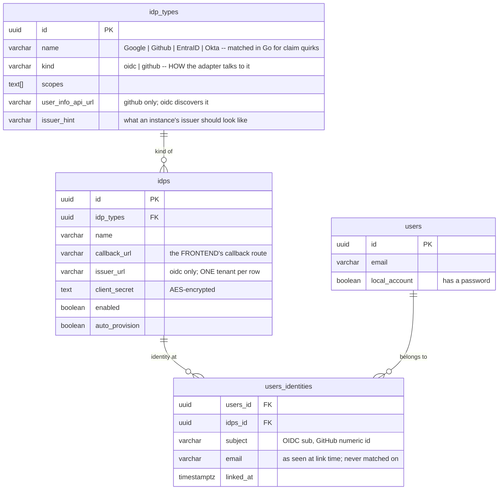
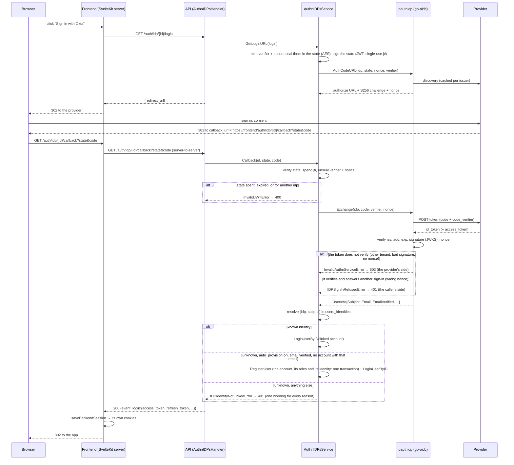
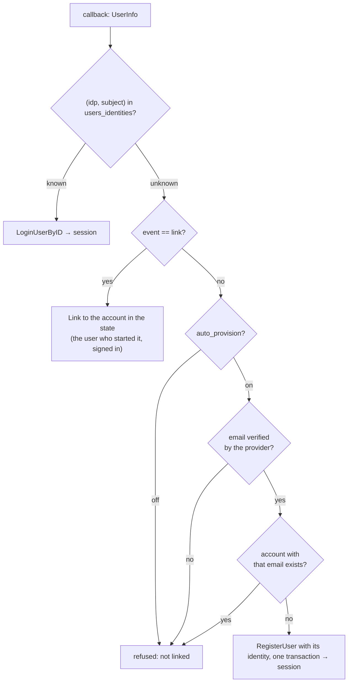
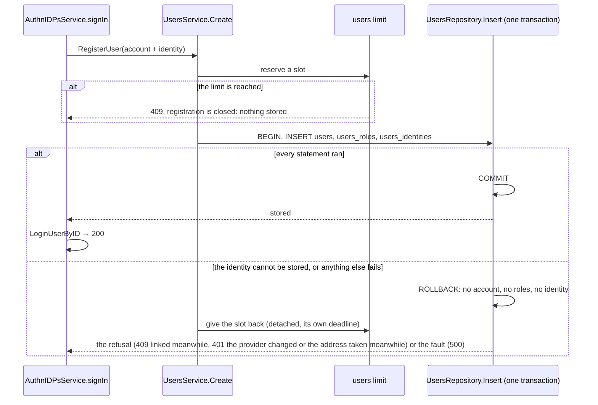
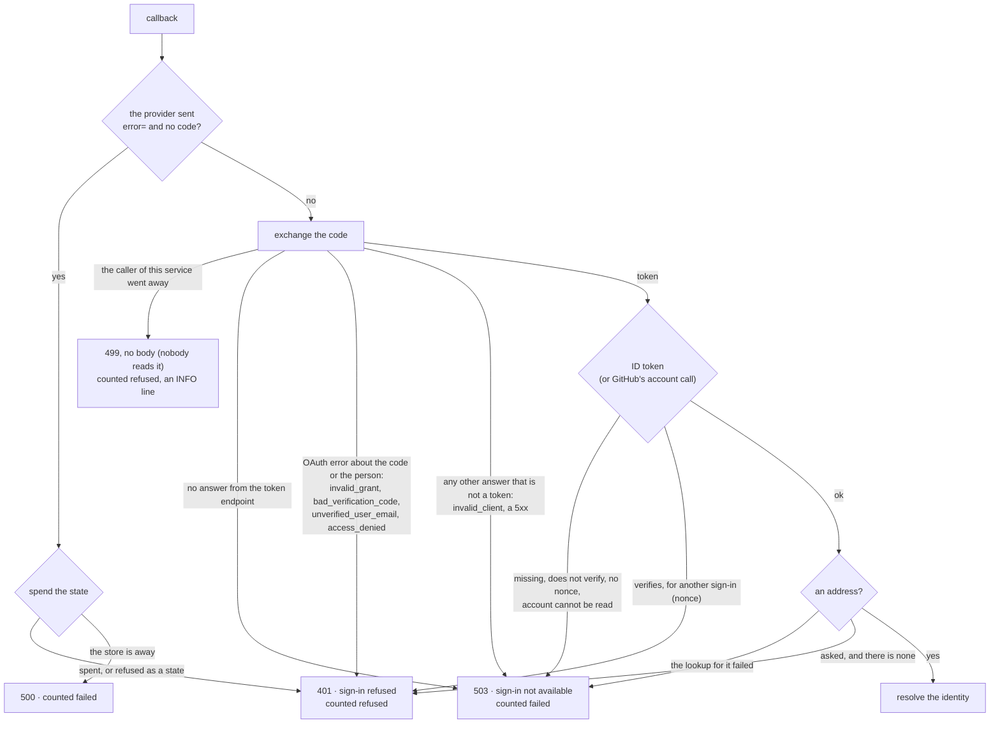
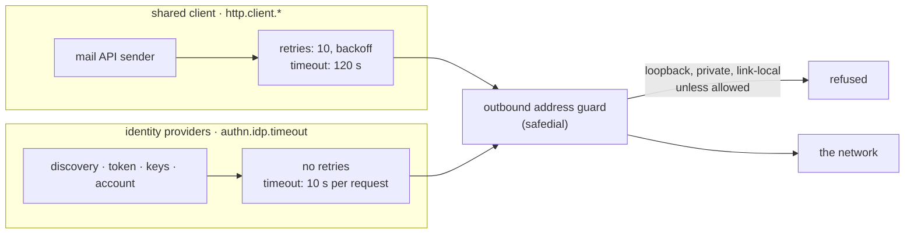
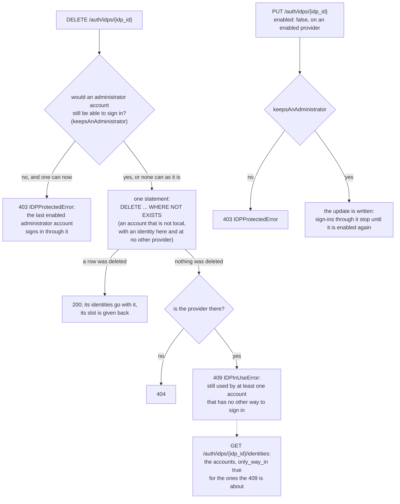
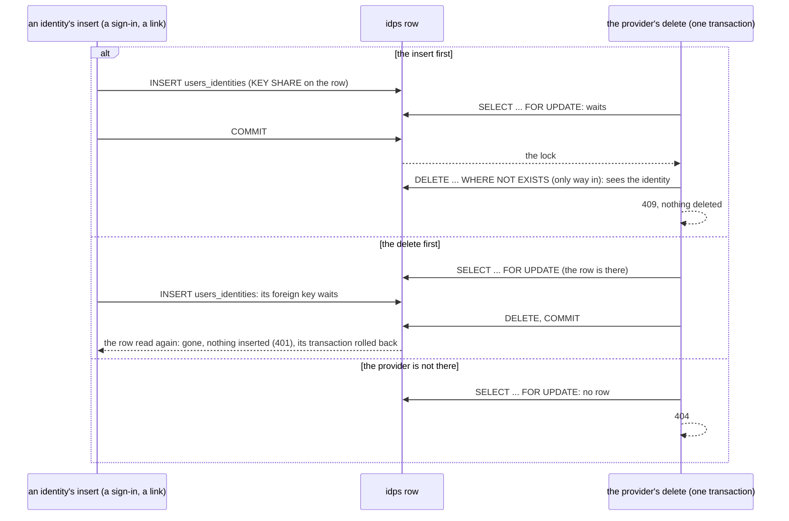
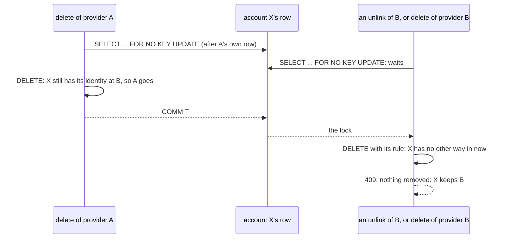
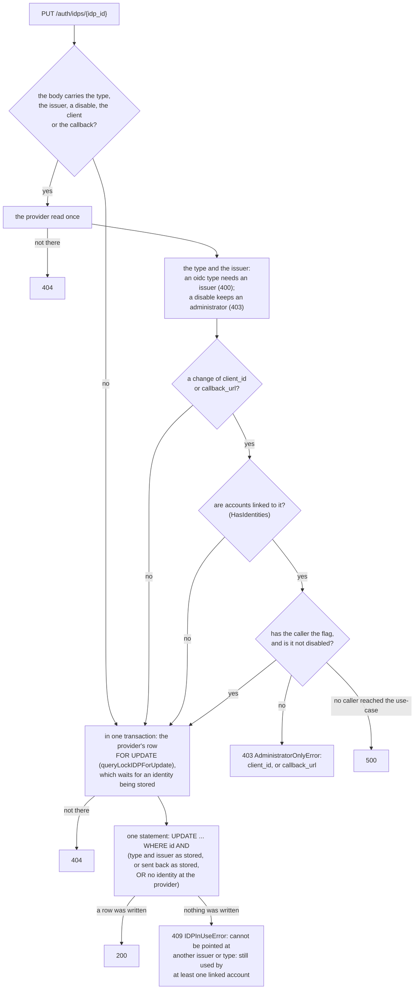

# Identity providers

How a person signs in through Google, GitHub, Microsoft Entra ID or Okta, what
this service trusts a provider for, and what it deliberately does not.

The short version: a provider proves a **subject**, never an email. The
identity is `(provider, subject)`, stored in `users_identities`; the email is a
hint used once, to create an account when the provider vouches for it. The
browser lands on the **frontend**, which talks to this API server-to-server;
this API sets no cookie and issues no redirect. OpenID Connect providers are
spoken to through discovery, with PKCE, a nonce and a verified ID token; GitHub
is plain OAuth2 with the primary verified email.

## The rows



**A type is a kind plus claim quirks.** `kind` decides the protocol; the
adapter used to switch on the *name* instead, so a row called anything but
`Google` or `Github` could be created and could never sign anybody in. The
name still matters for one thing: the per-vendor claim mapping (Entra ID's
`preferred_username`, see below).

**The issuer lives on the instance.** Google's is a constant; Entra ID's and
Okta's contain the tenant or the org, so a type cannot carry it. One tenant per
row, deliberately: the issuer is what the ID token's `iss` must equal, and a
second tenant is a second row rather than a `common` endpoint plus an
allow-list this service would have to maintain.

**`client_secret` is `TEXT`.** It holds ciphertext, and Okta's secrets are
already 64 characters in the clear.

## A sign-in, end to end



### What the callback used to do, and why it moved

The API was the provider's redirect target. It set three cookies **with the
frontend's cookie names on its own host** and redirected to a per-IdP
`login_redirect_url`. That worked in development only because both ran on
`localhost` — cookies ignore ports — and would have failed the first time the
API and the frontend had different hostnames: the SvelteKit server never sees
a cookie set for another host. It also contradicted the rule the frontend is
built on, that the browser never holds a token the API issued to it.

The callback now answers JSON, sets nothing and redirects nowhere. The
provider's `redirect_uri` is the frontend route, which exchanges state and
code with the API the same way it exchanges a password with `/auth/login`,
and stores the tokens with the same code. The two redirect URLs left the
`idps` row: where the browser lands is the frontend's decision.

## Identity, not email



**The refusal is one message for every branch.** Which addresses have
accounts here is not something whoever controls a provider account gets to
learn from the difference between "unverified" and "already registered".

**What it replaces.** `LoginUser` used to be called with the provider's email
and no password: it looked the account up by email, signed in, and if the
account was a local one set `local_account = false`, disabling the password.
Nothing proved the email belonged to the account — the provider's word was
enough, and an Entra administrator, a GitHub user with an unverified address,
or anyone at a provider that lets emails be changed could sign in as any
account whose address they could make a provider assert. `LoginUser` keeps its
one job, passwords; IdP sign-ins go through `LoginUserByID` after resolution,
and no login path changes the account on the way through.

**Linking is the holder's act.** A signed-in user starts
`GET /auth/idp/{id}/link`; the state carries their account id, sealed; the
callback attaches the identity to that account. The session proves the
account, the provider proves the identity, and it is the only moment both are
in hand. `GET /me/identities` lists them; `DELETE /me/identities/{idp_id}`
removes one — refused when it is the only way into an account with no
password, because nothing could sign in to it afterwards.

## What each provider is trusted for

| Provider | Kind | Subject | Email | Verified? |
| --- | --- | --- | --- | --- |
| Google | oidc, issuer `https://accounts.google.com` | `sub` | `email` | `email_verified` claim |
| Okta | oidc, issuer `https://<org>.okta.com/oauth2/default` | `sub` | `email` | `email_verified` claim |
| Entra ID | oidc, issuer `https://login.microsoftonline.com/<tenant>/v2.0` | `sub` (pairwise per app registration, stable for this row) | `email` if the optional claim is configured, else `preferred_username` when it is an address | **by construction**: one tenant per row, the address is the directory's own attribute |
| GitHub | github, fixed endpoints | numeric `id` (survives a rename; the login does not) | primary address from `/user/emails` (`/user.email` is null when private) | that address's `verified` flag |

Entra ID's trust is the one worth restating: there is no `email_verified`
claim, and the choice to treat a single tenant's addresses as verified is a
policy, recorded here and in the adapter, not a fact the provider asserts. The
scopes seeded for GitHub are `read:user user:email`; the old seed carried
`github:email` and `github:profile`, which are not GitHub scopes.

## The state token

Signed by this service, single-use, and it carries three things sealed with
the AES key in a `data` claim: the PKCE verifier, the nonce, and — for a link —
the account. Sealed because the state is readable by whoever sees the URL, and
the verifier must not be. Spent **before** the code is exchanged, on the
`revoked_tokens` denylist, so a state that survives a failed exchange cannot be
retried. A replay is refused with the same wording as any other bad state.

## A first sign-in is one transaction

A first sign-in through a provider, with `auto_provision` on, creates an
account and stores the identity that says whose it is. They were two
writes: `RegisterUser`, then `Link`. When the second failed (the identity
linked by a concurrent sign-in, the provider deleted meanwhile, a fault),
the first stayed: an account with no password and no identity, which nobody
could sign in to, holding the address and a slot of the users limit. The
person's next sign-in found an account with their email that was not linked
to them, which is the takeover the flow refuses, and was refused, every
time, until an administrator deleted the account.

The identity travels with the registration now (`RegisterUserInput.Identity`,
`InsertUserInput.Identity`), and `UsersRepository.Insert` writes the
account, its auto-assigned roles and the identity in its one transaction:
both, or neither. The users slot is reserved before the transaction and
given back when it fails, and the release runs off the request's context,
with a deadline of its own: a client that walks away cancels the request,
and a release on that context failed the same way and left the counter one
too high. An address taken between the sign-in's check and its create (a
registration by the form, the same sign-in twice) is answered as the check
answers it, an identity that is not linked; the registration form's rule
for a taken address (answer "registered", mail the owner) is the form's
alone, since a sign-in told "registered" went on to sign in to an account
it had not created.



`TestIDPFlowAFirstSignInThatCannotStoreItsIdentityLeavesNoAccount` makes the
database refuse the identity of one subject with a trigger, as a fault and
as a link made meanwhile, and checks that no account is left, the slot is
back, and the person's next sign-in works; on the two-write code the account
stayed, the slot did not come back, and the next sign-in was refused. In the
unit suite: `TestAnAccountIsStoredWithItsIdentity` (the three statements, on
the transaction), `TestAnAccountsIdentityIsTheAccounts` (an identity for
another account, or for a local one, is refused),
`TestAnOAuthRegistrationCarriesItsIdentityIntoTheCreate`,
`TestIDPCallbackProvisionsAndLinks`, `TestIDPCallbackARefusedRegistrationSignsNobodyIn`,
`TestATakenAddressIsAnsweredAsRegisteredOnlyOnTheForm` and
`TestAReleasedSlotIsGivenBackAfterTheRequestIsCancelled`.

## What can go wrong

| Failure | Answer | Why |
| --- | --- | --- |
| the provider sends the person back with `error=` (cancelled, denied) | 401, "did not complete the sign-in" | the provider's description goes to the log, not the caller; the state is spent, it had its one callback |
| a code the provider does not accept (`invalid_grant`: spent, expired, issued to another client; GitHub's `bad_verification_code` and `unverified_user_email`) | 401, "did not accept this sign-in" | the person's side: starting again can work |
| the provider was asked for the account's address and has none | 401 | nothing to provision or match by |
| state missing, spent, expired, for another idp, unsealable | 400 | one wording |
| discovery unreachable, or the token endpoint does not answer | 503, at start and at the callback; at the callback one fixed sentence, "sign-in with this identity provider is not available right now" | discovery is cached per issuer afterwards; the providers' client does not retry, so a token endpoint that refuses the connection is answered at once (see [the providers have a client of their own](#the-providers-have-a-client-of-their-own)) |
| the provider rejects this service (`invalid_client`, `unauthorized_client`), answers 5xx, returns no ID token or one that does not verify (issuer, audience, expiry, signature, no nonce), or the call for the account or its address fails | 503, the same sentence | the sign-in is out for everybody, and trying again does not help the person; go-oidc's and the provider's text is the failure's `detail` on the request's ERROR access line, never returned (it was a WARN of the adapter's with no context, a second line for the same failure; then a DEBUG one, which an operator at INFO never saw) |
| the provider row cannot be signed in with: no client id, secret or callback, an OpenID Connect provider with no issuer, a kind the service does not know | 503, at start and at the callback, the same sentence | the API refuses each of these shapes, so the row was written some other way: the service's side. It was a 400 that named the provider, on routes anyone may call; the reason is the failure's `detail` on the access line (`TestAProviderThatCannotBeUsedIsTheServicesSide`, against a running service) |
| the state cannot be signed | 500 | the service's own failure, its cause on the access line; it was a 400, after a line of its own at ERROR |
| the ID token verifies and answers another sign-in (wrong nonce) | 401 | the person's side |
| identity unknown and not provisionable | 401, one wording | see above |
| identity already linked elsewhere (link) | 409 | the other account keeps it |
| a first sign-in's identity cannot be stored (linked meanwhile, a fault) | 409, or 500 | no account is stored either, and the users slot is given back: see above |
| the provider was deleted, or pointed at another issuer or type, while signing in | 401, "the identity provider changed while signing in; sign in again" | nothing is stored under a provider that did not vouch for the subject: see "Pointing a provider elsewhere" |
| a first sign-in when the users limit is reached | 409, "registration is closed: the user limit has been reached" | the route is public: the limit error's own text names the scope, both limits and the usage |
| the account a link was started for was deleted before the callback | 404, a fixed sentence | it was a 500; the error's own text names the account's id |
| provider disabled | 404 at start, at the callback, and absent from `/auth/idp/available` | a half-configured provider is never offered |

### Whose failure a failed callback is

A callback that fails at the provider is one of three things, and the status
says which:



They were one error, `InvalidAuthnServiceError`, which the status table
called a 401, and the callback answered it 401. Two things followed. A
provider that was down, or that rejected this service's client secret after
a rotation, told every visitor "sign-in refused", and nothing on the
dashboards said the sign-in was out: the call was counted `refused`. And a
person who pressed Cancel at the provider was the same error as an outage.
The caller's side is `IDPSignInRefusedError` (401) now; what stays
`InvalidAuthnServiceError` is a 503, in the table and at the callback, and a
token endpoint that does not answer is `IDPUnreachableError`, as discovery
already was. The two are told apart in the log and on the metric; the
public body says one sentence for both, because that it is this service's
own registration the provider rejects is not an anonymous caller's to read.

A sign-in cancelled at the provider spends its state. It had its one
callback; left unspent, the same state was accepted with a code for the rest
of its fifteen minutes, and measured that way: a cancelled sign-in's state,
presented again with the code the provider had issued, signed in and created
the account.

Three cases sit on neither side by their first appearance. *An account
without an address* is the person's side only when the provider was asked
and said so: when the call for the address failed (a user-info outage, a
GitHub provider row without the scope for it), nobody knows, and it is a
503. *No nonce at all* in the ID token is a provider not following the
protocol, a 503; a different nonce is a 401. And *a request cancelled
because the caller of this service went away* is not the provider's
failure: the cancellation goes back as it is, and the callback answers it as
every request its caller abandoned is answered (see
[observability.md](observability.md#a-call-says-how-it-ended-ok-refused-or-failed)):
499 with no body, counted refused, its access line at INFO with
`error_type` `context.Canceled`. It was a 500, counted failed, an ERROR line,
for a tab closed during the exchange
(`TestTheIDPCallbackOfACallerWhoWentAwayIsNotA500`).
`TestExchangeFailureSaysWhoseItIs` holds the classification,
`TestOIDCExchangeAgainstATokenEndpointThatRefuses` and
`TestGithubARefusedSignInIsNotAnOutage` what the OAuth client library hands
back for each answer of a real token endpoint (GitHub answers an error
inside a 200, form-encoded), and `TestIDPCallbackARefusedSignInIsNotAnOutage`
the statuses against a running service.

### The providers have a client of their own

Every outbound request of the service went through one client: two minutes
for a request, ten retries with backoff (`http.client.*`). For a sign-in,
it was wrong twice:

```text
measured 2026-10-24, one callback, against the suite's provider
                              shared client                own client
token endpoint answers 502    503 after 173 s, code         503 in 0.04 s, code
                              presented 22 times            presented once
connection refused            503 after 154 s               503 in 0.08 s
token endpoint invalid_client 503, code presented twice     503, code presented once
```

Twenty-two is eleven attempts (the first and ten retries), twice: the OAuth
library then presents the failed exchange again with the credentials in the
other place, and that one is retried as well.

- **A person was waiting.** The 503 was the right answer and arrived after
  nearly three minutes, with a public route holding a connection
  for each visitor meanwhile.
- **The request it retried was the token POST**, whose authorization code is
  good for one exchange. A retry of a POST the provider did receive can only
  be refused: a provider that spent the code and then answered 502 answered
  the retry `invalid_grant`, and that outage was a 401.



The identity providers' client is built on the same transport settings and
the same address guard, with **no retries** and `authn.idp.timeout` (10 s by
default, between 1 s and a minute) for each request. Discovery is the one
call a retry could have helped, and it is cached per issuer after its first
success; a sign-in that fails on it is one the person starts again. A token
endpoint that answers 5xx is now that answer, classified as the provider
misbehaving, not a transport error after the retries.

**A failed exchange is presented once.** Left to itself, the OAuth library
probes how a provider wants the client's credentials: in the
`Authorization` header first and, on any failure, again in the form. So an
exchange that failed for its own reason (a spent code, a provider that was
down) was sent twice. The place is decided before the exchange: what the
discovery document's `token_endpoint_auth_methods_supported` declares
(`client_secret_basic` when it is listed, or when nothing is, which is
OpenID Connect Discovery's default; the form when only `client_secret_post`
is), and the form for GitHub.

`TestTheIdentityProvidersClientDoesNotRetry` holds the client (one attempt,
a refused connection reported at once, the address guard), and that the
shared client still retries, which is the reason there are two.
`TestAFailedExchangeIsPresentedOnce` and
`TestGithubAFailedExchangeIsPresentedOnce` hold the single exchange and
where the credentials go. Against a running service,
`TestIDPCallbackARefusedSignInIsNotAnOutage` counts the exchanges the
suite's provider receives (one, for a code it does not accept, for a
service it rejects and for a 502) and
requires a provider that does not answer to be answered within five
seconds.

## Configuring a provider

| Field | Meaning |
| --- | --- |
| `idp_type_id` | one of the seeded types; decides kind and claim mapping |
| `issuer_url` | required for the oidc kind, refused for github; the type's `issuer_hint` shows the shape |
| `callback_url` | `https://<frontend>/auth/idp/<idp_id>/callback`, registered verbatim with the provider |
| `client_id`, `client_secret` | from the provider's app registration |
| `enabled` | offered and accepted; off while setting up |
| `auto_provision` | may a first sign-in with a verified email create an account |

At the provider: register the callback URL exactly; for Entra ID add the
`email` optional claim to the ID token or accept the UPN fallback; for Okta
assign the app to the users who should sign in.

## Deleting or disabling a provider

A provider's delete takes its identities with it: `users_identities.idps_id`
cascades. It asked nothing first. An account that signs in through that
provider and has no password (`local_account` false) was left
with no way in at all, for nobody to sign in to. A provider created again
does not give it back, since its sign-in finds an account with the address
that is not linked, which it refuses. Recovery by e-mail sends such an
account nothing (`silentRecovery`): a password is a local account's to
recover.

Unlinking the last identity of such an account was already refused ("this
is the only way into the account"). The provider's delete is the same act
for all of them at once.

**The delete is a 409 while an account's only way in is an identity at that
provider. A disable is allowed, unless it would leave no administrator
account that can sign in.**



- **The rule is in the delete's own statement** (`queryDeleteIDP`), so the
  provider is kept by the rows as they are when it runs. Not by the foreign
  key: `ON DELETE NO ACTION` would keep the provider while any identity
  exists, also the one of an account that signs in with its password.
- **Which accounts keep it**: not a local account, an identity at this
  provider, and none at another. A disabled account counts: enabled again,
  it would have no way in. An account with a password does not, and neither
  does one with an identity at another provider, whatever that provider's
  state.
- **What an administrator does instead**: disables the provider. Or deletes
  those accounts, or makes them local accounts (`local_account: true`), which
  lets recovery mail them a link to choose a password. Which accounts those
  are is a list of its own, below.
- **Which accounts the 409 is about is a list of its own**
  (`GET /auth/idps/{idp_id}/identities`). The 409 says to delete those
  accounts or make them local first, and nothing listed them: the only
  listing of identities was `/me/identities`, and the users list cannot say
  which hang off a provider. The provider's identities list answers the
  accounts linked to it, each with when it was linked and `only_way_in`,
  the delete's own rule (no password, no identity at another provider; held
  to `queryDeleteIDP` by `TestAProvidersAccountsAreMarkedByTheDeletesRule`),
  under the users' sort, filter and fields, a missing provider a 404. The
  subject is not shown. `only_way_in` is the delete's rule and not the
  unlink's: an identity at another provider counts whether that provider is
  enabled or not. The Administrator role's `Allow all` reaches the route,
  and so does the `ReadOnly` role's read of every endpoint, which already
  lists every account through `GET /users`; what it adds is which accounts
  are linked where. `TestAProvidersAccountsAreListed` lists, filters, pages,
  and then removes what it names and deletes the provider.
- **A disable is not held to that rule.** It takes away nothing that enabling
  does not give back, and it is the way out of the 409. It is held to one
  thing: an administrator account must be left that can sign in.
- **The last door** (`IDPsService.keepsAnAdministrator`). The `admin` flag
  may be held by an account that signs in through a provider and has no
  password. With every other administrator account disabled, which is
  allowed while that one can sign in, its provider is the last door:
  disabling it, or deleting it under an account that also has an identity at
  a disabled provider, left no administrator account that could sign in, and
  so nobody to change an address or unlock another administrator account.
  (The provider itself can still be enabled by an account with its route's
  grant: what is kept is the account.) Both are a 403 for everybody: the
  routes are the Administrator role's, and the role is not the flag. When no
  administrator account can sign in as it is, there is nothing left to keep,
  and nothing is refused.
- **"A way in" means two things, and each is where it belongs.** *Can sign
  in now*: a password login, or an identity at a provider that is enabled.
  That is the count of administrator accounts (`enabledAdministrator`, one
  predicate for "how many", "how many without this provider" and "is this
  account one of them"), and it is what an account must keep when it
  unlinks an identity of its own (`keepsAWayIn`): an identity at a disabled
  provider is not one, and counted as one it let an account unlink its only
  door. *Could sign in again without the database*: any other identity,
  whatever its provider's state. That is the delete's rule, because
  enabling a provider gives its identities back and deleting one does not.
- **The count and the write are two statements**, as every check of this
  kind in the service is.
- **A delete waits for a sign-in through the provider.** An identity's
  insert (a first sign-in's, a link) holds a `KEY SHARE` lock on the
  provider's row, through its foreign key, until it commits. The delete's
  statement read its condition on a snapshot without that identity, waited
  for the lock, and went ahead after it without reading the condition again
  (the row had been locked, not changed): its cascade removed the identity
  just written, and an account that had just signed in had no way in. The
  delete is one transaction now and takes the row `FOR UPDATE` first
  (`queryLockIDPForDelete`), which waits for the insert; its statement then
  reads the identities as they are (READ COMMITTED takes a snapshot per
  statement). The lock also says whether the provider is there.



  A first sign-in stores its account and its identity in one transaction
  ([below](#a-first-sign-in-is-one-transaction)): when the delete comes
  first, no account is stored either.
- **An account's ways in are removed one at a time.** The delete's rule
  reads an account's other identities, and it held only its own provider's
  row: the two providers of an account that has no other way in, deleted in
  the same instant, each saw the other's identity and both went, and so did
  a delete and an unlink of the account's other identity. Every write that
  removes a way in takes the account's row first, `FOR NO KEY UPDATE`: the
  provider's delete takes the rows of the accounts linked to it, in the
  order of their ids, after its own row (`queryLockAccountsOfIDP`), and the
  unlink, which is one transaction now, takes the account's row and then
  deletes with the rule in its statement (`queryUnlinkIdentity`; the
  use-case's `keepsAWayIn` is still asked first, and answers the ordinary
  case). The second write waits for the first and reads what it left: a
  409, and the account keeps its last way in. Each keeps its own rule (the
  delete's counts an identity at a disabled provider, which enabling the
  provider gives back; the unlink's does not, above): what is serialised is
  the reading, not the rules. A provider's disable takes no account's row,
  and the count of administrator accounts that can sign in
  (`keepsAnAdministrator`) is a statement of its own before either write:
  two deletes or disables of an administrator account's two providers can
  each pass it. `FOR NO KEY UPDATE` does not conflict with the `KEY SHARE`
  an identity's insert takes on the account, so a sign-in into the account
  is not held, and the id order keeps two deletes that share accounts from
  deadlocking: the second waits for the first.



`TestAnIdentityProvidersDeleteStrandsNobody` holds the delete against a
running service (an account whose only way in it is, a disabled one, one
with a password, one with an identity elsewhere, several accounts of which
one keeps it, a provider nobody uses, a missing one, and the disable that is
allowed instead). `TestAnIdentityAtADisabledProviderIsNoWayIn` holds the
count, the count without a provider, the question about one account and
what an identity says of its provider. In the unit suite:
`TestAProviderIsNotDisabledUnderTheLastAdministrator`,
`TestAProviderIsNotDeletedUnderTheLastAdministrator`,
`TestAProvidersGuardDoesNotGuessTheCount` (either count failing),
`TestTheProvidersServiceNeedsItsCount`, `TestAnUnlinkKeepsAWayIn`,
`TestADeleteThatDeletedNothingSaysWhy`,
`TestTheProvidersDeleteKeepsItForAnAccountWithNoOtherWayIn` and
`TestWhoCountsAsAnAdministratorThatCanSignIn` (the statements, whole),
`TestAProvidersDeleteLocksItsRowBeforeItsCheck` (the two locks, and that the
delete runs after them in its transaction) and
`TestAnUnlinkTakesTheAccountBeforeItsRule` (the unlink's lock, its statement
and their order). Against a running service,
`TestAProvidersDeleteWaitsForASignInThroughIt` plays the first race: a
transaction of its own holds an account's identity uncommitted, the delete
is seen waiting on its lock, and after the commit it is a 409 with the
identity kept (it was a 200, and the account had no way in).
`TestAnAccountsWaysInAreRemovedOneAtATime` plays the four others the same
way (a provider's delete under an unlink of the account's other identity
and under the delete of its other provider, an unlink under each of the
two): a 409 each, the account keeping one identity; on the code before, a
200 and an account with none.

## Pointing a provider elsewhere

An identity is (provider, subject), and a sign-in is "this provider says
this subject", then a session for the account. The issuer and the kind are
what "this provider" means. `PUT /auth/idps/{idp_id}` could change both
while the provider's identities stayed, keyed by its id: whoever holds that
route (the Administrator role, which is not the flag) pointed the provider
at an issuer of their own, asserted a subject that is linked, and was signed
in as that account. A subject is not shown by the API, and at many
providers it is no secret. It also shut, with no refusal, the door of an
administrator account that signs in through the provider, and the counts
went on taking the repointed provider for a door.

**Another issuer or another type is a 409 while the provider has identities
(a new provider instead). Where its sign-in goes, the client and the
callback, may change, and while accounts are linked that change is the
administrator account's to make.** The client and the callback together are
a takeover too: set to an application and a host of one's own, at the real
issuer, a linked user's ordinary sign-in sends the code to that host, and at
a provider whose subjects are global (GitHub, Google) that code is a session
as the user. The state does not help: it is sealed by the service and
carries the PKCE verifier, and it is not bound to the browser that started
the flow.



- **The type and the issuer, in the update's own statement**
  (`queryUpdateIDP`), as the delete's rule is in its: the provider is kept
  by the rows as they are when it runs. A value equal to the stored one is
  no change: a form sends the whole provider back, and a github provider's
  sends an empty issuer, which is its stored one. A provider nobody is
  linked to may be pointed anywhere.
- **For everybody, the administrator account too.** The identities are the
  accounts', and the issuer is what says who they are; a provider for
  another issuer is a provider of its own.
- **The client and the callback are the administrator account's while
  accounts are linked** (`signInMayChange`). An application registered
  again, or a frontend that moved, is ordinary, and it is the account that
  answers for every account that does it. It may shut doors, its own
  included: whether the identities match afterwards is the provider's to
  say (some issue one subject per application), and that is not refused.
  The 403 tells a caller with the providers' grant that accounts are linked
  to the provider, which the grant otherwise does not show; it says nothing
  of which. The check and the write are two statements.
- **The secret, the name, the logo, the switches** change as before. A
  secret alone does not move the sign-in: the code is issued to the stored
  client.
- **An identity is stored only under the provider as the sign-in used it.**
  The check above reads the identities as they are when the update runs,
  and a sign-in reads the provider when it starts, perhaps through the
  cached copy (best-effort invalidation). A sign-in in flight while the
  provider is repointed, because nobody was linked to it yet, stored an
  identity that an issuer of someone else's had asserted: the update did
  not wait for the identity's insert, since an `UPDATE` that changes no key
  column takes only `FOR NO KEY UPDATE`, which does not conflict with the
  insert's `KEY SHARE`. So the update and the identity's insert take the
  provider's row against each other, and the insert names the provider it
  signed in with:

  - The update takes the row `FOR UPDATE` in its transaction before its
    statement (`queryLockIDPForUpdate`).
  - The insert is `INSERT ... SELECT ... FROM idps WHERE id AND idp_types
    AND issuer_url ... FOR KEY SHARE OF idps` (`queryLinkIdentity`), with
    the type and the issuer the sign-in used (`LinkUserIdentityInput`; the
    issuer compared as the reads answer it, `''` for a github provider,
    whether the row holds NULL or `''`). The foreign key says the provider
    is there; this says it is still the provider that vouched for the
    subject. A row that was updated meanwhile is read again, by Postgres,
    before the insert writes.
  - Nothing written is a 401 `IDPChangedDuringSignInError` ("the identity
    provider changed while signing in; sign in again"). On a first sign-in
    the identity is written in the account's transaction, so no account is
    stored either; a link answers the same, and so does a provider deleted
    while the sign-in was under way.
  - **An existing identity is found the same way.** The sign-in looks the
    identity up by the provider, the subject, and the kind and issuer it
    used (`SelectBySubject`). Read by the provider and the subject alone, a
    sign-in held at the old issuer, or reading a cached copy, proved a
    subject with an issuer the provider no longer trusts and was signed in
    as the account linked to that subject under the new one: a takeover of
    any account linked after the repoint, by whoever answers for the old
    issuer. Not found under the provider as it signed in, the identity is
    one this provider does not know, and the insert that would provision it
    refuses the provider as changed (401); with provisioning off it is the
    401 of an identity that is not linked.
  - A sign-in that read the provider from a cached copy older than a
    repoint is refused the same way, and again on every attempt until the
    copy is invalidated or expires: the repoint invalidates it, best
    effort. It is a sign-in that does not happen, never one under the
    wrong issuer.

  Whichever comes first, the other waits for its commit and then reads what
  it wrote:

  ```mermaid
  sequenceDiagram
      participant S as sign-in (insert)
      participant DB as idps row
      participant U as PUT (update)
      alt the insert first
          S->>DB: FOR KEY SHARE, issuer and type as signed in: matches
          U->>DB: FOR UPDATE (waits)
          S->>DB: commit (the identity stored)
          DB-->>U: lock granted
          U->>DB: UPDATE ... OR no identity: reads the identity
          U-->>U: nothing written → 409 IDPInUseError
      else the update first
          U->>DB: FOR UPDATE
          S->>DB: FOR KEY SHARE (waits)
          U->>DB: UPDATE (another issuer), commit
          DB-->>S: the row read again: the issuer differs
          S-->>S: nothing written → 401, no identity, no account
      end
  ```

  A change of the name, the secret or the switches leaves the type and the
  issuer as they were, and the sign-in goes on. The client and the
  callback are not in the insert's condition: a change of those while
  accounts are linked is the flag's, and a sign-in in flight then still
  holds the code issued to the client it started with.

`TestAProviderIsNotRepointedUnderItsIdentities` holds it against a running
service: another issuer under an identity, by the role and by the flag;
another type; the type and issuer sent back with a new name; a github
provider's form; a provider nobody is linked to; the client and the callback
under an identity, by the role and by the flag, and where nobody is linked;
a missing provider. `TestASignInStoresNothingUnderAProviderRepointedMeanwhile`
holds a first sign-in at the provider's token endpoint, repoints the
provider, and lets it go: a 401, no identity, no account; on the code
before, a 200 and an identity under an issuer that never vouched for it.
`TestASignInWaitsForARepointUnderWay` is the other order: the repoint
played by a transaction of the test's own (the row `FOR UPDATE`, then the
new issuer), held open while the sign-in stores its identity: the insert
waits, reads the row again after the commit, and stores nothing (401); on
the code before, the foreign key waited too, found the provider there, and
answered 200. `TestARepointWaitsForAnIdentityBeingStored` stores an
identity in a transaction of its own while the repoint is sent: the update
waits, and after the commit it is a 409 with the issuer unchanged; on the
code before, a 200 and the provider pointed elsewhere.
`TestASignInDoesNotSignInUnderAProviderRepointedMeanwhile` is the read
side: a sign-in held at the old issuer while the provider is repointed and
an account is linked to the same subject under the new one is a 401, and
nobody is signed in; on the code before, and with the insert's check alone,
a 200 and a session for that account. In the unit suite:
`TestAnIdentityIsFoundOnlyUnderTheProviderItSignedInWith` (the lookup's
condition and its arguments), `TestAKnownIdentityIsLookedUpUnderTheProviderAsItSignedIn`,
`TestAnIdentityIsStoredOnlyUnderTheProviderItSignedInWith` (the insert's
statement, the lock, the update's order, and the arguments in the
statement's order at both inserts),
`TestAProvidersUpdateKeepsItForItsIdentities` (the statement, whole),
`TestAnUpdateThatWroteNothingSaysWhy`,
`TestWhereAProvidersSignInGoesIsTheAdministratorsWhileAccountsAreLinked`
and `TestAProvidersUpdatePassesTheCaller`.

## What it used to do, and why that was wrong

- endpoints chosen by the type's *name*, so `parseUserInfo(raw, idp.Name)`
  failed for any row not literally named `Google` or `Github`;
- no PKCE, no nonce, no ID token: plain OAuth2 and a user-info fetch, with
  the token exchange on `http.DefaultClient` and no timeout;
- `AccessTypeOffline` + `ApprovalForce` on every provider — Google-only
  options, forcing consent on every sign-in elsewhere;
- GitHub sign-in failed for anyone with a private email or a one-word name;
- accounts matched by email, `local_account` flipped on the way in;
- cookies set by the API on its host, redirect to a per-row URL;
- callback failures answered as JSON to a browser navigation;
- no `enabled` flag, no URL validation, every listing decrypting every secret.
