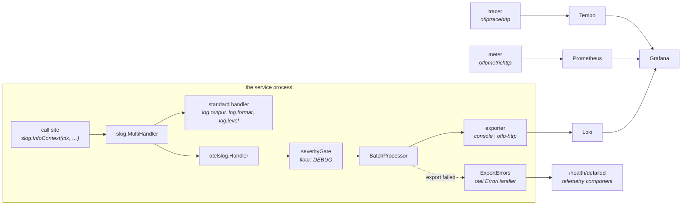
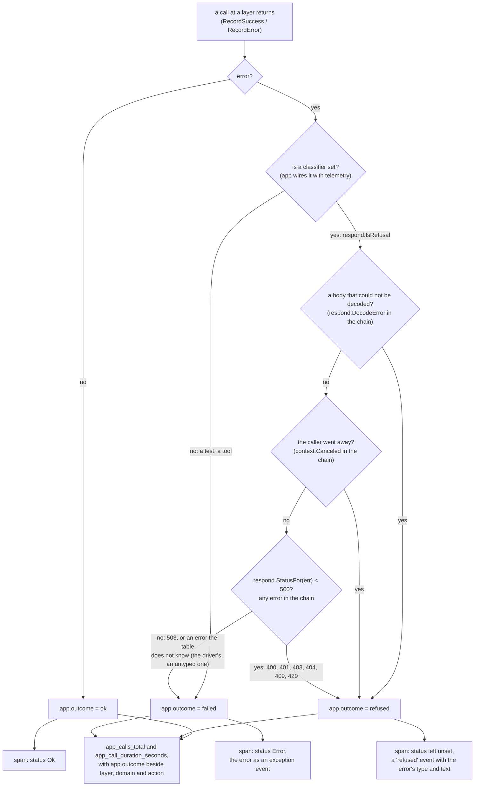
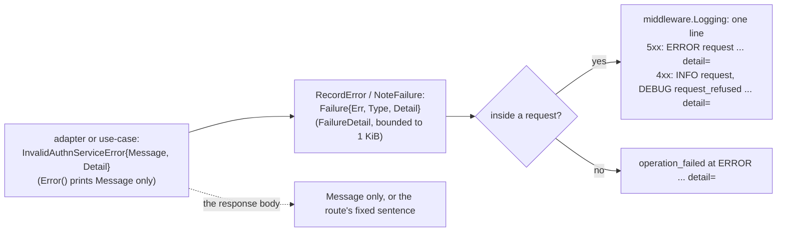
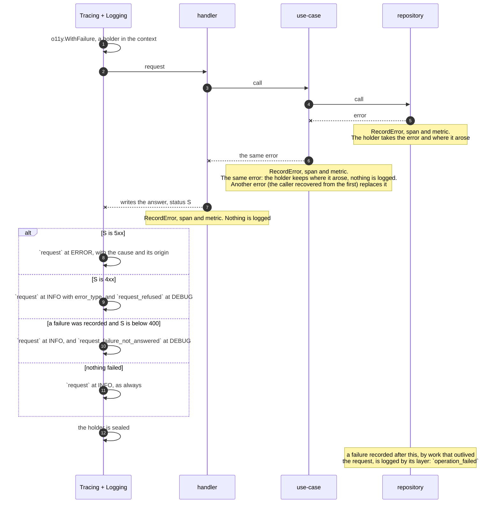
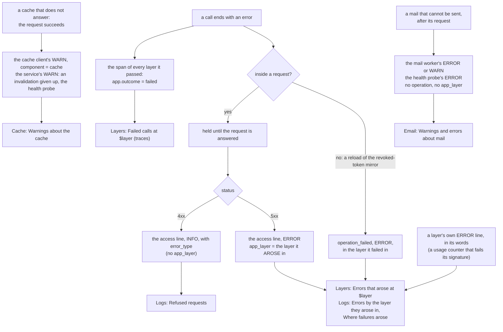
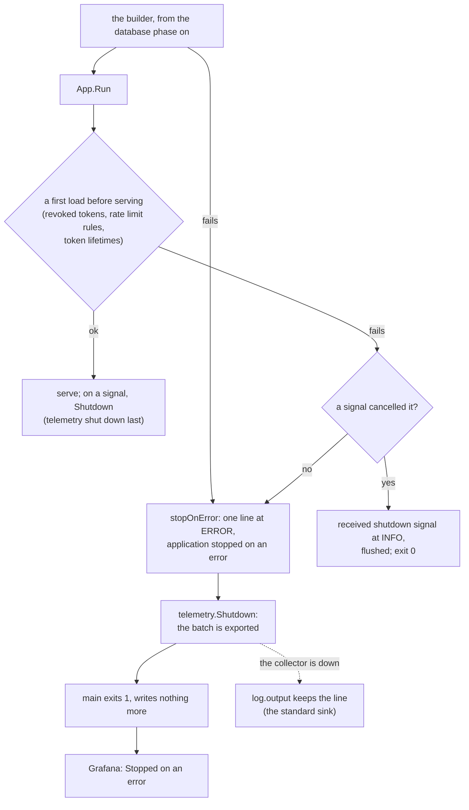
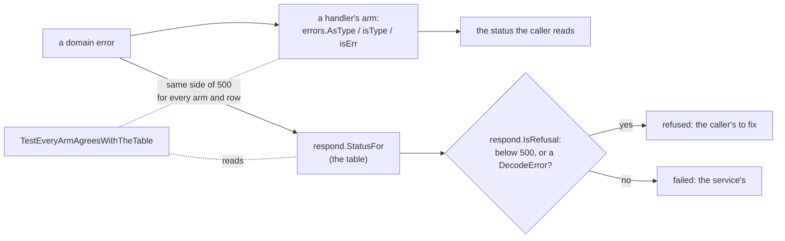

# Observability: three signals, one trace id

`go-rest-api-service-template` emits all three OpenTelemetry signals. Traces and metrics have
been here since the start; **logs joined them** and are the subject of most of
this page, because they are the signal with a second sink, a deliberate
disagreement between the two, and a rule about what may leave the process.

- The package is [`internal/o11y`](../../internal/o11y). Its package comment is
  the API tour; this page is the mechanism and the reasoning.
- The dev stack that receives the three signals is
  [`dev-env/`](../../dev-env) — Tempo, Prometheus and Loki behind one Grafana.

## The shape



## The vocabulary: one instrument pair, the layer as an attribute

Every layer records on the same two instruments:

| | |
| --- | --- |
| `app_calls_total` | counter |
| `app_call_duration_seconds` | histogram, seconds |

and the layer travels as the `app.layer` attribute, alongside `app.domain` and
`app.action`. Those six values are the only ones it takes:

| `app.layer` | Hexagon ring | What it is |
| --- | --- | --- |
| `handler` | driving adapter | the HTTP port. A gRPC handler would report the same layer; the protocol is an attribute on the span, not a layer |
| `usecase` | core | the business logic |
| `repository` | driven adapter | persistence, whatever implements it |
| `cache` | driven adapter | Valkey |
| `mail` | driven adapter | the mail transport |

**The values name port roles, not packages.** Swapping `repositorypg` for
another driver must not rename a metric or invalidate a dashboard.

**The ring is documentation, not a label.** No panel would ever ask for "all
driven adapters together" — one asks for `repository` or `cache` by name — and it
is derivable from the layer. A label nobody queries is cardinality nobody
wanted.

### What this replaced, and why

There used to be six instruments — `handler_calls_total`,
`service_calls_total`, `repository_calls_total` and a duration histogram each —
so the layer was encoded in the metric **name**. That is backwards from how
OpenTelemetry's semantic conventions work, where a dimension is an attribute
(`http.server.request.duration{http.route}`) and never part of the name, and it
was paid for daily:

```promql
# before: a regex over metric names
sum by (app_layer) (rate({__name__=~"(handler|service|repository)_calls_total"}[$__rate_interval]))

# after
sum by (app_layer) (rate(app_calls_total[$__rate_interval]))
```

A dashboard variable over the layer was not expressible at all before; now it
is just `app_calls_total{app_layer="$layer"}`.

Adding a layer used to mean a fourth copy of a per-package constants file and
two more metric names for every dashboard to learn, which is why the driven
adapters were instrumented unevenly and a layer breakdown stopped at the
repository.

Series count is unchanged — the same layer × domain × action combinations, in
one family instead of three.

`service` became `usecase` in the same change. The package has been `usecase`
since the ports refactor, and next to `service.name` and `service_name` the old
spelling read as "the whole binary" rather than "the core".

### A call says how it ended: ok, refused or failed

Both instruments carry `app.outcome`:

| `app_outcome` | The call returned | What it means |
| --- | --- | --- |
| `ok` | no error | it worked |
| `refused` | an error the service answers with a 4xx: a bad field, a row that is not there, a wrong password, a limit | the caller got it wrong and was told so. The service worked |
| `failed` | any other error | the service, or something it depends on, did not work |

There used to be one boolean, `successful`, and `successful="false"` counted
the last two as the same thing. A burst of bad requests -- a client in a retry
loop on a 404, a scanner, a form that validates on the server -- raised every
error ratio on every dashboard, and a database that had really gone away
raised it no more than that. The number an operator reads to ask "is the
service broken?" could not answer it.



- **One list.** What makes an error a refusal is how the service answers it,
  and that is one table, `respond.StatusFor`
  ([below](#which-errors-are-refusals-one-table)). `o11y` cannot import the
  HTTP adapter (it is imported by it), so the composition root hands the
  question over as a function (`o11y.SetRefusalClassifier(respond.IsRefusal)`,
  in `initTelemetry`). An error type added to the table is classified without
  a second place to remember.
- **A body that could not be decoded is a refusal, and is in no table.** It
  is answered by its own helper (`respond.WriteDecodeError`: 400, or 413),
  and its errors are `encoding/json`'s and `io`'s, with no type of ours.
  `handler.decodeJSONBody` marks every failure as a `respond.DecodeError`,
  and four authentication routes, which recorded a fresh "failed to decode
  request" in place of the decoder's error, record the decoder's: a login
  body cut by the size bound was a 400 with that sentence, where every other
  route answers 413 (`TestNoHandlerReplacesTheDecodersError`).
- **A request its caller abandoned is a refusal, and is in no table either**
  The client closed the connection before the request was answered:
  a tab closed while a sign-in's code was being exchanged, a client that
  gave up on its side. Every layer returns the request's own
  `context.Canceled` on the way up, and it was a 500, counted `failed`, with
  an ERROR access line, for something nobody did wrong and nobody receives.
  `IsRefusal` knows the sentinel, and `respond.WriteCallerGone` answers it
  `499` with no body when the request's context is the one cancelled.
  Every site that answers an error with a 500 asks it first:
  `WriteInternalError` (and so `WriteError`), and the three that write a
  sentence of their own (`CheckAuthz` and the two health checks) -- `TestEvery500AsksWhetherTheCallerWentAway` reads the HTTP
  adapter for a 500 written without it. So the status and the outcome agree.
  The access line is INFO, as every 4xx, with `error_type`
  `context.Canceled` (`errorType` names the sentinel, an `*errors.errorString`
  like any `errors.New`), and the server span is not red.
  `context.DeadlineExceeded` is not matched: a cache read past its timeout, a
  generation past `llm.generate.timeout`, is something slow, and a failure.
  No route declares 499: nobody receives it.
  `TestACallerWhoWentAwayIsNotAnError` holds the line, and
  `TestACallerWhoWentAwayIsAnsweredNothing` the writer and the classifier.

  What it does not change, and what it can hide:

  - **The cache counts its own.** c3e records the `cache` layer itself, and
    a read whose request was cancelled is neither a timeout nor a miss to
    it: `failed` on `app.layer=cache`, and a WARN line of the library's own,
    as before. Every other layer is counted `refused`.
  - **Slowness behind a proxy reads as callers leaving.** A proxy or load
    balancer that gives up before this service does closes the connection,
    and what was slow -- a saturated pool waiting in `Acquire`, a slow query
    -- ends as `context.Canceled`: 499, `refused`, INFO, where it was a
    500, `failed`, ERROR. nginx's 499 has the same ambiguity. The error
    ratio does not see it; the duration histogram does, and a rise of 499
    on the Logs dashboard's "Requests by status" is the sign to look there.
  - **A write timeout over HTTP/2 is the service's own cancel.** With
    `http.server.write.timeout` set (off by default), Go's HTTP/2 server resets the stream at the deadline, which
    cancels the request's context: the service's deadline, read as the
    caller leaving.
  - **The classifier sees the error, not the request.** A
    `context.Canceled` raised while the caller is still there would be
    answered 500 and counted `refused`. Nothing in the request path cancels
    a context of its own.
- **Decided per call, not when the request ends.** The log line waits for the
  HTTP status because it is one line per request. A metric is one count per
  call at a layer, recorded when the call returns. A first sign-in through an
  identity provider looks the identity up and is told "not found": that
  repository call was `refused`, whatever the request goes on to do; the
  use-case recovers from it and its own call is `ok`. The request's own
  outcome is the handler layer's.
- **A call is recorded with its operation.** Two not-found returns of the
  identity providers' repository recorded with `nil` attributes, and a
  suite run showed `app_calls_total` series with an outcome and no
  `app_layer`, `app_domain` or `app_action`, which no panel reads.
  `TestNoCallIsRecordedWithoutItsOperation` fails on a recorder given `nil`.
- **A repository records the error it returns.** Two of
  `ProjectsRepository.Insert`'s returns recorded the driver's error and then
  returned the mapped one: a name that already exists was a failure at the
  repository and a 409 to the caller. They map first, and
  `TestARepositoryRecordsTheErrorItReturns` fails on the shape.
- **Unset, every error is a failure.** A test or a tool that serves no
  request never sets a classifier, and calling an error a refusal needs a
  reason.
- **`successful` stayed for one release** (`v0.0.4`), on the same series, so
  a saved query or an alert outside this repository did not go blank at the
  swap, and is gone since: a query that still reads it matches nothing. The
  dashboards here read `app_outcome`; `TestErrorPanelsCountFailuresNotRefusals`
  fails on a panel that goes back, and `TestACallSaysHowItEnded` on a point
  that carries `successful` again.
- **`cache` and `mail` say it themselves.** They mirror their operations onto
  the shared pair in their own code, not through `o11y`'s recorder, so each
  sets `app.outcome` there: `ok`, or `failed` for an error (and, for the
  cache, a read past its query timeout, which falls back to the database:
  the request is answered and the cache did not work). Neither has a
  refusal: nothing a caller sent reaches them as a request to turn down.
  `TestWhoeverRecordsOnTheLayerInstrumentsSaysTheOutcome` holds every
  function that records on the pair to it. Their specialised instruments
  keep their own `result`.
- **The outcome is the error's, not the response's, and a handler that does
  not answer through the table can disagree with it, in either direction.**
  A handler that answers a 4xx of its own for an error the table calls a
  5xx is counted `failed`; one that answers 500 whatever the error
  (`respond.WriteInternalError` with no look at the type) is counted
  `refused` when the error happens to be one the table calls a 4xx. Each
  such handler should answer through `respond.WriteError`, so that the status
  and the outcome come from the same table. Every `WriteInternalError` call
  of the handlers (136) was read against what its use-case returns, and six
  sites an error of the table reaches were wrong, five of them a 500:
  - an administrator's policy update to a grant no endpoint serves (the
    create's 404);
  - a role linked to a policy that is not there, which the grant guard reads
    to learn what it grants (404);
  - an identity unlinked from an account that was deleted meanwhile (404);
  - the identity-provider callback of a link whose account was deleted (404);
  - and the system's user limit reached at a self-registration (409), or at
    a first sign-in through a provider, which answered 409 already, in the
    limit error's own words.

  The first three answer through `respond.WriteError` now. The other three
  are public routes, and the errors' own text names the account's id, or the
  scope, both limits and the usage: each is an arm with a fixed sentence,
  "registration is closed: the user limit has been reached" for the limit.
  `handler/table_status_test.go` holds each site to "a refusal is answered
  below 500, a failure at 500 or above". The other sites are a response that
  could not be encoded, a payload mapper, the subject read from the context,
  or a use-case that returns no error of the table once the handler has
  validated its input; a default arm stays a bare 500 there, because on a
  public route `WriteError` would print the text of whatever 4xx arrives
  there next. One way in is left, and it is not these handlers': an address
  with a quoted local part (`"a b"@example.com`) passes the handler's check
  and is normalised to a form (`a b@example.com`) that the use-case's own
  check of the same rule refuses, so registration, recovery, verification
  and the users routes answered that refusal 500. It is fixed in the
  address's validation (#158): the spelling of an address is an address.
- **A request that reaches a handler without its caller is a fault, at
  every site.** Thirty-three handler functions ask the request for the
  account it was authenticated as, and two for the verified token. The
  authentication middleware puts both on every request it lets through, so
  their absence is a route wired without that middleware, never a caller's
  mistake. The helpers returned an `InvalidJWTError`, the table's 401:
  eleven sites answered 500 for it, counted `refused`; eighteen answered
  400 or 401, sixteen with the error's text and two with "Invalid or
  expired token", telling a caller their token was at fault. The other six
  read the claims by hand (`callerFromContext`'s four callers, `logout`,
  `resetPassword`) and answered a 500 counted `failed` already, but
  `resetPassword` wrote its reason into the 500's body. The helpers return a type of the handler package that the table has
  no row for (`noCallerError`), and every site answers
  `respond.WriteInternalError`: the fixed 500, counted `failed`, the cause
  on the access line. `TestARequestWithoutACallerIsAFaultAtEverySite` drives
  all thirty-five and fails when a new site is not among them;
  `TestEverySiteAnswersAMissingCallerWithTheFixed500` reads the answer from
  the source.

An error ratio is therefore the failed calls over all calls:

```promql
100 * sum(rate(app_calls_total{app_layer="handler",app_outcome="failed"}[$__rate_interval]))
    / clamp_min(sum(rate(app_calls_total{app_layer="handler"}[$__rate_interval])), 0.001)
```

### The span says the same

A span carries `app.outcome` too, and its status follows it:

| The call | Span status | On the span |
| --- | --- | --- |
| `ok` | Ok | nothing more |
| `refused` | **unset** | an event named `refused`, with `error.type` and `error.message` |
| `failed` | Error | the error as an `exception` event, as before |

Every call that returned an error used to be marked Error. A request answered
404 was then a trace with a red span at every layer it passed through, and a
trace backend's `status = error` was a list of the requests clients got
wrong. The server span has followed the HTTP rule since it was introduced,
only a 5xx is an Error; the spans under it did not.

- **Unset, not Ok.** It is what OpenTelemetry asks of a 4xx on the server
  side: the call did not succeed, and it is not the service's error either.
- **An event, not an exception.** The refusal stays on the span for whoever
  opens the trace of a complaint. It is not an `exception` event, which is
  what a fault is and what a backend highlights.
- **Per call, as the metric is,** and for the same reason plus one: a span
  ends when its call returns, and a status cannot be set on a span that has
  ended. Nothing below the middleware could wait for the HTTP status.
- **Ask a trace backend by outcome**: `{ span.app.outcome = "failed" }` is
  the calls that failed; `{ status = error }` now returns the same traces,
  and no refused request among them.

`TestARefusedCallIsNotARedSpan` and its neighbours in
`o11y/span_outcome_test.go` hold the three rows.

### One name means one description

Every construction of an instrument with a given name must agree on its
description, or the SDK reports a duplicate-instrument conflict and the
disagreeing registrations export as separate, half-populated series. With the
layer in the name this was invisible — each layer had its own instrument, so
each could describe itself differently, and three spellings had drifted in,
including `"Duration of %s handler calls"` on a repository. Sharing one name
makes agreement mandatory, so the text lives in one place and
`o11y.NewLayerMetrics` is the only thing that builds the pair.

### Buckets

`app_call_duration_seconds` sets its boundaries explicitly, 1 ms to 10 minutes.
The SDK default stops at 10 seconds, which is survivable while every layer is a
database call measured in milliseconds and is not once the same instrument
times a slow outbound dependency, which can run for far longer — the reason the
server has no write timeout. Everything past the last bucket lands in `+Inf`,
so a p95 over a slow dependency would be pinned at 10s and tell nobody
anything.

### Adapters keep their own instruments too

`cache` and `mail` record the shared pair **in addition to** their specialised
ones, never instead. The two answer different questions: `cache_requests_total`
measures what only a cache has (hit, stale, miss, timeout, per entity) and that
vocabulary is meaningless on a shared instrument, while the shared pair
measures what every layer has, so a layer breakdown includes them instead of
stopping at the repository and leaving a hole where a real dependency sits.
Different instrument names, so nothing is double-counted.

## What identifies a replica

Four attributes are set once on the resource, so they reach all three signals
at a time and cost nothing per record.

| Attribute | Source | Loki promotes it? |
| --- | --- | --- |
| `service.name`, `service.version` | build metadata | `service_name` yes |
| `service.instance.id` | a fresh uuid per process | yes |
| `host.name`, `process.pid` | the SDK's detectors | no |
| `deployment.environment.name` | `opentelemetry.environment` | yes |

**`service.instance.id` was missing, and the gap was invisible.** The SDK only
sets it behind an experimental flag. The dashboards carry an `instance`
variable keyed on it, and a variable over a label nothing sets resolves to
empty — while `service_instance_id=~""` still matches every series. So the
panels worked, the variable was dead, and nothing said so. It was found by
asking Prometheus which `service_*` labels it actually had, which is a question
worth asking of any label a dashboard depends on.

It is a fresh uuid per process because that is what the specification asks for:
a restarted process **is** a new instance, and an id that survived a restart
would make two processes' series look like one. `host.name` carries the
friendly name alongside it — in Kubernetes, the pod.

A consequence worth knowing: Loki promotes `service.instance.id` to a label, so
**one process is one stream**. That is the intent, and a restart starting a new
stream is correct. In the dev stack, where `air` rebuilds on every save, the
24h retention is what bounds it.

### There is no default environment

`opentelemetry.environment` is empty by default, and empty means the attribute
is not emitted at all. `development` would label a production replica wrongly
until somebody noticed, and `production` would do the reverse. Both are worse
than nothing, because **a wrong label is acted on and a missing one is asked
about**. The dev stack sets it explicitly in `run.sh` and `.air.toml`.

It is bounded to 63 characters because Loki makes it an index key, repeated on
every stream.

`resource.Default()` is merged in rather than replaced, which is what keeps
`OTEL_RESOURCE_ATTRIBUTES` working — the way a deployment adds its own
attributes with no code change.

## Logs are a second sink, never a replacement

`opentelemetry.log.exporter` adds a destination. It never takes `log.output`
away, and that is not a convenience:

- The lines written **before** telemetry exists have nowhere else to go. A
  rejected flag, an unreadable `.env`, a deployment still running the seeded
  administrator's password — all of these are logged while no exporter has been
  built.
- A container platform that collects stdout must keep working while the log
  collector does not. Losing telemetry costs visibility in Grafana; it must
  never cost the local record.

So the pipeline is *composed* onto the default logger rather than installed in
place of it (`App.composeLogger`), and a deployment that wants only the store
points `log.output` at `/dev/null` — a flag that already exists.

| `opentelemetry.log.exporter` | `log.output` | OTEL pipeline | Use |
| --- | --- | --- | --- |
| `noop` (**default**) | every record | none | local work, `kubectl logs`, any deployment with no log store. Identical to the behaviour before this setting existed. |
| `console` | every record | OTLP records pretty-printed | seeing the record the SDK *would* ship: its resource, severity number and attributes. Not a sink — everything it prints is already on stdout in the handler's format. |
| `otlp-http` | every record | batched OTLP/HTTP to `opentelemetry.log.{endpoint,port,path}` | Loki (the dev stack, `run.sh` and `.air.toml`) or an OpenTelemetry Collector |

`opentelemetry.log.path` is a setting because the two destinations disagree
about it: **Loki serves `/otlp/v1/logs`, a Collector serves `/v1/logs`.** It is
the same reason the metric exporter builds a full URL — Prometheus' OTLP
receiver sits under a prefix too.

### Why logs default to `noop` when traces and metrics default to `console`

Traces and metrics have nowhere at all to go without an exporter, so a console
default is the only way to see them. Logs already have somewhere. A `console`
default would print every line a second time, in a different shape, to the same
terminal — and `noop` is exactly what every deployment did before the setting
existed, so an upgrade changes nothing until an operator asks for it.

## TRACE never leaves the process

This is the one place the two sinks deliberately disagree, and it is a
constant, not a setting.

`cslog.LogLevelTrace` is where this service logs the things that are useful
next to a terminal and dangerous anywhere else:

- every SQL statement **with its arguments**, which on the authentication path
  are password hashes and token hashes;
- every outbound HTTP request and response body.

`.air.toml` and `run.sh` run the dev stack at that level on purpose. A
searchable, retained log store is the wrong destination for those lines, so
`o11y.ExportedLogFloor` raises the exporter's minimum severity to `DEBUG`
whatever `log.level` says:

```
-log.level=ctrace   →   stdout: TRACE and above      exporter: DEBUG and above
-log.level=warn     →   stdout: WARN and above       exporter: WARN and above
```

Raised, never lowered: a service running at `warn` exports `warn` and above.

**Why a constant and not an `opentelemetry.log.level` flag.** A flag can be
raised. With one, shipping SQL arguments to a log store would be one operator's
typo away, in production, with no review — and there is no value in that flag
that anybody wants and cannot get another way. The floor also makes the
"no secrets above TRACE" rule below enforceable rather than aspirational.

The gate is an `sdklog.Processor` that implements both `Enabled` and `OnEmit`.
`Enabled` is the cheap half — the slog bridge asks before building a record, so
a suppressed `cslog.Trace` costs an integer comparison rather than an
allocation. `OnEmit` is the correct half — the SDK documents that `OnEmit` is
called independently of `Enabled`, so a bridge that skips the question must
still be filtered.

## What the custom levels become

`otelslog` maps a `slog.Level` to a severity by a constant offset, and both of
this service's custom levels land where they should with no special handling:

| slog level | value | OTEL severity | exported? |
| --- | --- | --- | --- |
| `cslog.LogLevelTrace` | -8 | `TRACE` (1) | **never** |
| `slog.LevelDebug` | -4 | `DEBUG` (5) | at `log.level=debug` or below |
| `slog.LevelInfo` | 0 | `INFO` (9) | yes |
| `slog.LevelWarn` | 4 | `WARN` (13) | yes |
| `slog.LevelError` | 8 | `ERROR` (17) | yes |
| `cslog.LogLevelFatal` | 12 | `FATAL` (21) | yes |

## Where the identifying attributes live

`application` and `version` are attached to the **standard handler**, in
`setupLogger`, before the pipeline is composed on. On the exported side the
same two facts are resource attributes (`service.name`, `service.version`)
carried once per batch. Repeating them per record would pay for them per line
and give a Loki query two spellings of one thing to choose between.

This falls out of composing at the handler level:
`slog.NewMultiHandler(slog.Default().Handler(), otelHandler)` — the attributes
are already inside the first handler and the second never sees them.

## The ordering invariant

```
LoadConfigs → setupLogger        the standard logger exists
     ↓
initTelemetry → Start → composeLogger    the pipeline is added as a second sink
     ↓
initDatabase, initRepositories, initServices, …
```

Anything that captures `slog.Default()` for its own use keeps whatever logger
existed at that moment. Two things do: the cache client and the outbound HTTP
client, both wired in `initServices`. If a phase that captures the logger moved
above `initTelemetry`, it would hold a logger with one sink and its lines would
silently stop appearing in the log store — with nothing failing and no error
anywhere. `TestLoggerConsumersAreWiredAfterTelemetry` asserts the order from the
source, because the failure is invisible at runtime.

`Start` brings the pipelines up in the order traces → metrics → logs, so a
record emitted during setup has a tracer to be correlated against. `Shutdown`
reverses it: the log provider's flush is the last thing that can produce a span.

## When export fails

Every pipeline is batched and asynchronous, so an export failure cannot be
returned to the call site — the call returned long before anything reached a
collector. The SDK reports failures to the process-wide handler, which is
[`o11y.ExportErrors`](../../internal/o11y/export_errors.go), and from there:

- `/health/detailed` → the `telemetry` component goes **degraded**, never
  unhealthy. Losing telemetry costs visibility, not service; failing readiness
  over it would take a working replica out of rotation because a collector is
  down, and since replicas share a collector, all of them at once.
- `telemetry_export_errors_total` → a metric, so it can be alerted on and it
  has history. It is genuinely useful in exactly one situation, and that
  situation is the common one: **the metric pipeline is fine and the log
  collector is down.** The counter rises in Prometheus while every dashboard
  keeps working, which is the only way that outage announces itself.

`ExportErrors.Handle` must never log. Since the log pipeline exports through
that same handler, a `slog` call there is a loop: the line is emitted, its
export fails, the SDK calls `Handle`, `Handle` logs again. It would spin exactly
when telemetry is already broken, and the first symptom would be a pegged CPU
rather than a degraded health check. `TestExportErrorsHandleDoesNotLog` pins it.

The health component also **dials** each collector, because with no traffic
there is nothing to export and a collector that has refused connections since
startup produces zero export errors. Logs are dialled separately from traces —
they are separate processes at separate addresses, Loki on 3100 and Tempo on
4318 — and the second dial is skipped when the two addresses agree, which is
what one Collector in front of both looks like. See
[health-probes.md](./health-probes.md).

## How a log line finds its trace

Three things have to line up, and each of them was missing.

### 1. The span has to exist above the code that logs

The server span used to start **inside** the handler, in `o11y.SetupTraceHTTP`.
A context does not flow back up out of `next.ServeHTTP`, so by the time the
request line was written the handler's span was gone. No amount of changing the
log call could have fixed that.

It now starts in `middleware.Tracing`, above `Logging` and below `Recovery`:

```
RequestID → Recovery → SecurityHeaders → RewriteStandardErrorsAsJSON
          → OtelTextMapPropagation   adopt the caller's trace context
          → Tracing                  open this service's span in it
          → Logging                  write the request line INSIDE that span
          → HeaderAPIVersion → MaxBody → RequireJSONBody → handler
```

A second thing falls out: a request refused **before** the handler — by the
rate limiter, the body limit, or authentication — now produces a span where it
used to produce none. Those are exactly the requests somebody goes looking for.

`http.route` must be the route and never the path: `/users/{id}` is one span
name, `/users/019822af-…` is one per user. The route is not known on the way
in, because `ServeMux` assigns `Request.Pattern` while it routes, so the span
opens under a placeholder and is renamed on the way out. The rename reads the
pattern off the request the middleware **passed down**, not the one it
received, because the mux sets it on the request it was handed. Whether that
works depends on nothing in between cloning the request, which is not
guaranteed by anything — so a test asserts it and fails if a future middleware
starts to.

Only 5xx marks a span as an error. A 4xx is the server working correctly and
telling a caller so; marking those `Error` turns the error rate in a trace
backend into a measure of how often clients send bad requests.

### 2. The call has to pass the context

`slog.Info` and `slog.InfoContext` differ in one way that matters: the bridge
reads the span from the context argument and from nowhere else. 340 call sites
across the request path were converted at once, by an AST rewriter rather than
by hand, taking the context from a parameter, from an `*http.Request`, or from
the enclosing function when the call sits inside a closure.

`TestNoContextlessSlogInTheRequestPath` keeps it that way. The rule decays
silently otherwise — nothing fails, no test goes red, the line simply is not
there when somebody clicks "logs for this span" during an incident. Its
exemptions are keyed on the **function** rather than the file, because a
file-level exemption would silently cover every call added to that file
afterwards. `internal/app` is out of scope entirely: its logging is startup and
shutdown, where no span exists and a context would have to be invented.

It walks every package under `internal/core` and `internal/adapter` but the
HTTP server's (the process's lifecycle, as `internal/app` is). Its packages
were listed by hand, and three that a request passes through were missing:
the identity providers' adapter (`oauthidp`, ten lines at WARN on a failed
sign-in, none reachable from its trace), the token verifier (`tokenjwt`) and
the middleware's validator (`jwtvalidator`), seventeen lines in all (#173).
The adapter writes no line of its own now: what it knows is the failure's
detail (2b).

### 2b. A failure's detail travels in the error

Some errors are answered in fixed words on purpose: a refused sign-in in one
sentence whatever the reason, so that the reason does not tell anyone which
addresses have accounts here; a provider that cannot be used in one sentence
on a public route, so that the provider's own text never becomes the API's.
The reason used to be a second line, at WARN, beside the access line about the
same failure. Moved to DEBUG (#173), it was out of an operator's sight at
INFO: an expired client secret was a 503 whose ERROR line said "the identity
provider did not accept this service's request", and nothing else.



The error carries a `Detail` its `Error()` never prints, read through
`FailureDetail()` (`domain/failure_detail.go`), and `o11y` holds it with the
failure, so the one line about it carries `detail`: the ERROR access line of a
5xx, the DEBUG `request_refused` line of a refusal, `operation_failed` outside
a request. It is text, not a wrapped error, so `error_type` is still the
domain type. It is bounded to 1 KiB; the identity providers' adapter puts an
OAuth refusal's code, description and status there and never its body, and
cuts any other failure's text at its first line and 200 bytes, because go-oidc
puts the provider's page into its errors ("<status>: <body>"). A refusal's
reason is often the caller's own text (the provider's `error_description`
comes back in the callback's query string), so it is written at DEBUG, on the
refusal's companion line, and bounded there too.
`TestTheLineAboutAFailureCarriesItsDetail` holds both lines;
`TestTheAdapterWritesNoLineOfItsOwn` holds the identity providers' adapter to
none.

### 3. Both sinks have to carry the ids

The bridge stamps `trace_id` and `span_id` on exported records. Nothing does
that for the standard handler, so `traceAttrsHandler` wraps it and adds the
same two attributes, under the same snake_case names, whenever a span is
current. A line scraped from stdout and a line delivered by OTLP then carry the
same field under the same name, so one Grafana derived-field rule covers both.

It has to reimplement `WithAttrs` and `WithGroup` to return its own type. The
cache client and the outbound HTTP client each capture `slog.Default().With(…)`
at wiring time, and a wrapper that dropped itself there would leave those two
components logging without trace ids — silently, and with nothing else to catch
it.

## The request line is the access log

One `Info` per request, written at the outermost point that has the trace. It
used to carry the method, path, peer address and status. What it was missing,
and why each matters:

| Field | Why |
| --- | --- |
| `duration_ms` | the first question anyone asks of an access log, and it could not answer it |
| `route` | the mux pattern. `/users/{id}` groups; a path does not |
| `client_ip` | resolved through the trusted-proxy policy. `RemoteAddr` behind a proxy is the proxy, logged identically for every caller |
| `bytes` | a slow endpoint returning a megabyte and a slow endpoint returning nothing are different problems a duration cannot tell apart |
| `trace_id` | via the context — the point of all of the above |
| `user_id`, `token_type` | "who was doing this" is the first question after "what failed" |
| `project_id`, `project_admin` | the tenant boundary. A slow or failing project was invisible, because nothing on the line said which one |

The response writer counts the bytes and returns an already-wrapped writer as
it is, so `Tracing` and `Logging` share one wrapper instead of stacking two.

### The subject reaches the line the same way the route does

The identity cannot simply be read where the line is written. The
authentication middleware puts the claims on a **new** request and passes it
down; the access log runs above it, holds the request it passed down, and never
gains that value — a context flows down and never back up. It is the same
structural problem that kept the trace id off the line.

So `Tracing` installs one pointer in the context, above everything that fills
it. The authentication and membership middlewares write through that pointer as
the chain descends; the access log and the server span read it on the way back
out. It is the pattern `otelhttp` uses for its labeler, and for the same
reason.

Both the writes and the read happen on the request's own goroutine — the writes
as the chain descends, the read after `next.ServeHTTP` has returned — so no lock
is needed. Nothing outside the middleware package can reach the pointer, which
is what keeps that true.

**The address is never recorded, only the `sub` claim.** An id identifies the
account for an operator without putting a person's e-mail in a retained,
searchable store. An anonymous request contributes no subject fields at all,
rather than a line padded with empty strings that read as "the empty user".

## A failed request is one line, at the level of its answer

The level of a line says whether someone has to act.

| The request was answered | What is written | Level |
| --- | --- | --- |
| 2xx, 3xx | the access line, `request` | INFO |
| **4xx**: the service refused it on purpose (a bad field, a row that is not there, a wrong password, a limit) | the access line with `error_type`; and one line `request_refused` with the error and where it arose | **INFO**; the detail at **DEBUG** |
| **5xx**: the service, or something it depends on, failed | the access line with `error_type`, the error, and where it arose (`func`, `file`, `line`, `app_layer`, `app_domain`, `app_action`). Nothing else | **ERROR** |
| not a request (a reloader, startup) | `operation_failed`, where the failure is handled | ERROR |

A refusal is the service working. It is never ERROR, and never WARN either:
at the volume of bad requests WARN would be the same noise one level lower,
and the WARN lines an operator should see -- a rule skipped, a count given up,
`authorization refused` for a caller who is not a member -- would be buried.
A spike of 401s or 429s is caught by a metric, not by a level.

**Every layer used to log.** `o11y.RecordError` is called by the repository
that raises an error, by the use-case that returns it and by the handler that
answers it -- 1 152 call sites -- and each call wrote an ERROR line,
`operation_failed`. Measured in svc-qu3ry-core, the service this template is
kept in step with and where the change was built, on the log of two runs of
its integration suite: 3 090 such lines, **98% of them for requests refused
on purpose and answered with a 4xx**, one refusal logged up to four times,
and eight requests answered with a 5xx -- whose access lines were INFO, like
every other. The ERROR level held refusals, and the failed requests were at
INFO.

Neither fault can be put right inside a layer, because no layer knows how the
request will be answered: a "not found" is a 404 on one route and a 400 on
another, where the missing thing was named in the body. Only the handler
decides, and only the middleware sees what it decided. So:



- **The holder is the mechanism the subject already uses** to reach the access
  line: a context flows down and never back up, but a pointer placed in it
  once, above everything, is reachable from both ends. `Tracing` installs it;
  `o11y.recordResult` writes into it; `middleware.Logging` reads it.
- **The failure kept is the one travelling up, where it arose.** The
  repository returns before the use-case does, and the layers above record
  the same error or a wrap of it, which does not replace it: the function,
  file and line that were logged three times are logged once.
- **A failure the caller recovered from does not mask the next one.** A first
  sign-in through an identity provider looks the identity up, is told "not
  found" and goes on to create the account; that lookup was recorded. An
  error that is *not* the held one or a wrap of it replaces it, so when the
  insert then fails and the request is answered 500, the line names the
  insert. With "the first one wins" it named the lookup, and the real cause
  was written nowhere (found in review, before this shipped).
  The same rule makes `error_type` the error the request was *answered* with
  where a layer answers with another error than the one below it recorded: a
  login for an address nobody has is a "not found" in the repository and an
  `InvalidCredentialsError` in the use-case, and the line says the second,
  from the use-case.
- **A 500 written for an error no layer recorded** -- a handler calling
  `respond.WriteInternalError` directly -- hands its cause to the same holder
  (`o11y.NoteFailure`), so that line too is the access line, with the cause.
  `NoteFailure` records its caller's caller as where the failure arose,
  because it is called through a helper (`WriteInternalError`); a middleware
  that answers a request itself calls it through `middleware.noteFailure`,
  for the same reason. Called straight from a middleware's closure the line
  named `net/http.HandlerFunc.ServeHTTP` (an authorization store fault in
  `CheckAuthz`), and from `Logging`'s deferred recover `runtime.gopanic`
  (`TestAMiddlewaresFailureIsSaidToAriseInIt`;
  `TestTheMiddlewaresNoteAFailureThroughTheirHelper` holds the package to
  the helper).
- **The holder is sealed when the line is written.** A context outlives its
  request: the cache refreshes a stale entry on `context.WithoutCancel`,
  which keeps the context's values and so the holder. `Logging` *takes* the
  failure (`o11y.TakeFailure`), and from then on the holder is no holder: a
  failure recorded by work that outlived the request is logged by its layer,
  not held for a line already written. What a refresh records *while* its
  request is still being answered can land on that request's line; the
  window is the few milliseconds between the stale hit and the response.
- **A panicking request has its line.** A panic used to leave `Logging`
  before the line was written, and what the layers had recorded went with
  it. `Logging` writes the line as the 500 `Recovery` is about to answer,
  with the panic as the cause, and lets the panic go on up; `Recovery`, above
  everything, logs `panic recovered` as before.
- **A middleware that answers 500 writes no line of its own.** The
  authorization check logged an ERROR and answered 500 for an error its
  use-case had already recorded: with the access line at ERROR that was the
  same failure twice. It logs only when there is no access line to carry it.
- **A response writes no line of its own either.** `respond.WriteJSONMessage`
  wrote a DEBUG record per response, with the response's text as its
  message: the access line again, and for a refusal a second detail line
  beside `request_refused`. It is gone.
- **`error_type` is the type of the error the request was answered with.** A
  request answered 2xx carries none, whatever a layer recorded on the way;
  what was recorded is the DEBUG line `request_failure_not_answered`.
- **No holder, no change.** Work that is not a request has no access line to
  wait for, and `RecordError` logs it itself, in each layer as before: a
  failure outside a request is still one `operation_failed` line for each
  layer it passes. That is left alone on purpose. A background job may
  recover from what a layer below it reported, and a failure held for an
  outer line that is then never written would be a failure nobody logged.
- **A middleware's refusal names no failure.** A 401 for a missing token, a
  403 from the policy, a 429: nothing below the middleware ran, nothing was
  recorded, and the status on the access line is the whole story.
- **None of the call sites changed.**

**Measured again in svc-qu3ry-core, on the same two runs of its suite.** ERROR
lines went from 3 096 to **28**, and each of them is something to act on:
the access line of each of the eight requests answered with a 5xx, with the
cause and where it arose, and twenty lines for faults that suite causes on
purpose outside a request or in a use-case's own words. Its 1 843 requests
answered with a 4xx are 1 843 INFO lines; 1 534 of them carry an `error_type`
and have their `request_refused` line at DEBUG, and the other 309 were
refused by a middleware.

**Measured here, on one run of this repository's integration suite, after the
change:** four ERROR lines, each the access line of a request answered 500
(three for a usage counter the suite tampers with on purpose, one for an
unlink of policies that the database refuses), 345 requests answered 4xx at
INFO, 266 of them with an `error_type`, and fifteen requests answered 2xx
that had recorded a failure on the way, each with its DEBUG
`request_failure_not_answered`. Those fifteen are deletes of a row that is
not there, which this service then answered as done: the repositories used
to log each at ERROR by hand ("operation failed"), twelve such lines in two
runs, and no longer do. (The role and policy deletes among them answer 404
since #164, and are refusals on the access line.)

`TestARefusedRequestIsNotAnError`, `TestAFailedRequestIsOneErrorLine` and their
neighbours in `middleware/request_level_test.go` drive a request through three
layers and count the lines, the recovered failure, the panic and the work
that outlives its request among them;
`o11y/failure_test.go` holds the holder.

### The log panels read the access line of a failure

A request answered 5xx writes its access line at ERROR, and that line carries
the layer the error **arose in**. A panel that reads the log by layer
therefore answers "where do failures start", not "which layers did a failure
pass through" -- that second question is the metric's
(`app_outcome="failed"` at each layer) and the trace's.



| Panel | Reads | What it cannot show |
| --- | --- | --- |
| Layers, **Errors that arose at $layer** | ERROR lines with `app_layer` = the layer | a request's failure that passed through the layer and arose below it |
| Layers, **Failed calls at $layer** | traces with a span of that layer whose `app.outcome` is `failed` | `cache` and `mail`, which open no span |
| Logs, **Errors by the layer they arose in**, **Where failures arose** | ERROR lines grouped by the operation they carry, and by `error_type` | a refused request. They count lines, not failures: a failed reload of the revoked-token mirror is `operation_failed` from the repository and the use-case's own ERROR line, which carries no operation |
| Logs, **Refused requests** | the access line of every 4xx, by `status` and `error_type` | which layer refused: the origin of a refusal is on the DEBUG line `request_refused`, exported only when `log.level` is debug or lower |
| Cache, **Warnings about the cache** | WARN and above with `component` = `cache`, and the service's two messages about the cache (`failed to invalidate cache`, `cache health check failed`) | a line about the cache written in other words |
| Email, **Warnings and errors about mail** | the mail library's two messages and the health probe's | a reworded message, after a bump of the library |

- **A panic is two ERROR lines**, the access line with the panic as its cause
  and `Recovery`'s `panic recovered`, which has no operation. It was three:
  `Recovery` answered through `respond.WriteInternalError`, which has no
  failure holder up there and logged the panic once more. It writes the fixed
  body directly now (`TestAPanickingRequestStillHasItsLine`).
- **The cache and mail panels had never matched a record.** Both filtered on
  `app_layer` `cache` and `mail`. Those two layers record the shared metric
  pair and open no operation, so no log line has ever carried their name.
  What is written instead was found by making each fail under a running
  replica, with the limiter off (as shipped, the limiter's store is the same
  Valkey and every request is a 429 first; see
  [running the service](../operations/running-the-service.md#cache)):
  - **Valkey stopped, twenty cached reads**: all answered 200, from the
    database. The cache client wrote 42 WARN lines with `component` =
    `cache` and no `app_layer` (`cache: query timeout reached, falling back
    to database`, `cache: failed to set cache`), and the health probe one,
    `cache health check failed, reads are falling through to the database`.
    The old panel's query found 0 lines in that window; the new one finds
    all 43.
  - **The mail server stopped, two registrations**: answered 201, and the
    mail library's worker wrote two ERROR lines, `error sending email`, with
    no operation and no layer. The old panel's query found 0; the new one
    finds both.

`TestLogAndTracePanelsFilterOnWhatTheServiceWrites` reads every query of a
dashboard -- a panel's, a data link's, an annotation's -- and refuses a log
filter on a key no line carries or on a layer that writes none, a trace
filter on a layer or an outcome that is not one, and a panel on the `$layer`
variable that does not say it is empty for `cache` and `mail`. On the
dashboards before this change it names four defects: the cache and mail
panels' layers, the Layers panel's silence about the two, and no trace panel
at all. A message the mail library writes, and not this repository, is
listed in `dependencyLines` beside the line-filter guard.

## What the key rules caught

The two rules above are tests rather than review habits because the failure
they prevent is silent and permanent: nothing breaks, the line simply exists in
a store that is retained and searchable by everyone who can read it. Each was
written after finding real lines.

**One SQL statement was logged at DEBUG, not TRACE.** 80 other SQL logs in the
same package already used `cslog.Trace`; this one was the outlier, and being
the outlier is why nobody noticed. DEBUG is above the export floor, so it
shipped — and it is `repository.Users.Insert`, which interpolates its
arguments: the user's e-mail address and their **bcrypt password hash**. The
TRACE floor was doing its job; this call was simply on the wrong side of it.

**Three WARN lines in the re-verification path carried the address** of every
account that asked to be re-verified. They now log `user_id`, and the one case
with no account to identify logs a reason instead.

**Two keys were named for something other than what they held.**
`"access_token"` and `"refresh_token"` on the startup line hold *durations*.
Besides being confusing on their own terms, they make any search for a leaked
token return that line. They are `access_token_lifetime` and
`refresh_token_lifetime` now.

**Twelve keys were camelCase**, including
a whole sentence used as an attribute key
(`"skipping languageID because it is the same as the embedding language"`, with
the id as its value).

## `error_type`, and why the message is not a key

The line of a failed request carries `error_type` as well as the message
(the access line `request`; `operation_failed` outside a request). Counting
failures needs something that does not change when the wording does: the
message is free text, it is often a wrapped vendor string, and a dependency
bump rewrites it — at which point a panel counting "how many times did *this*
failure happen" silently starts counting two things, or nothing.

It reports the type at the **bottom** of the wrap chain, because that is where
the cause is. `fmt.Errorf("selecting the user: %w", pgx.ErrNoRows)` is a
`*fmt.wrapError` all the way up, so reporting the outermost type would give one
value for every distinct failure in the service.

It is deliberately **not** a metric attribute. The set of error types is
bounded by the code rather than by traffic, but it is large, and the metric
already carries `app_outcome="failed"` with the layer, domain and action — which is
the question a metric should answer. "Which error" is a log question, and the
log line is joined to the metric by the trace id.

The HTTP status and the failure are on the same line, and the core was not
given the response writer to put them there, which is the one thing the
hexagon forbids. The layers hand the failure up, through a holder in the
context, to the middleware that knows the status (see "A failed request is
one line" above). They used to be two lines joined by a trace id: the
failure at ERROR whatever the status, and the status at INFO whatever the
failure.

## The operation reaches every record without a call site saying so

`app.layer`, `app.domain` and `app.action` are on the span and on the metric.
On a log record they were on exactly **one** line — `operation_failed` —
because every other call site would have had to pass them by hand, and 368 call
sites passing three attributes each is a rule nobody keeps.

So the operation rides the context. `o11y.SetupTrace` already knows it and puts
it there; `operationAttrsHandler` adds the three attributes to every record
written while it is in scope. A log store can then filter by layer, domain and
action the same way the metrics do: *every line this repository call wrote*
becomes a query rather than a regex over message text.

**It wraps the composed logger, not the standard handler.** That is the one
thing the first version of this got wrong, and it is worth recording because
the failure was invisible. `traceAttrsHandler` wraps the standard handler only,
which is right for trace ids — the bridge puts those on the exported record
itself. Nothing put the operation on the exported side, so the attributes went
to stdout and never to the log store, and **the bridge supplying `trace_id`
there hid it**: the records looked correlated. It showed up only on asking the
live stack how many exported lines actually carried `app_layer`. The answer was
3 of 294 when this was measured upstream.

A line written outside any operation gets no attributes rather than three empty
ones, which would read as "the empty layer" and pollute every filter. Most
exported lines are in that category and correctly so: startup and shutdown, the
access log (which carries `route`, `status`, `duration_ms`, `user_id` and
`project_id` instead), a cache fetcher closure and its detached revalidation
goroutine, which take their own context and genuinely run outside the request's
operation.

## The message says what happened

A log line whose message is an identifier and whose content sits in an
attribute is backwards: the message is the one field every viewer shows without
being asked.

224 messages named the operation. Now that the operation is on the record as
attributes, naming it in the message is the same fact twice — once filterable,
once not. They were rewritten in four groups:

| Was | Now |
| --- | --- |
| `"usecase.Users.LinkRoles", "what", "invalidate cache"` | `"invalidate cache"` — the description was already there, in an attribute |
| `"repository.Users.Insert", "query", …` | `"sql", "query", …` |
| `"usecase.Users.GetByID", "cache", "enabled"` | `"cache lookup", "cache", "enabled"` |
| `"usecase.AuthnIDPs: could not sign the state"` | `"could not sign the state"` — the prefix is now `app_layer` and `app_domain` |

28 remain whose message is the operation and whose only content is attributes.
They were left alone deliberately: writing prose for each is a judgement about
what that particular line reports, and inventing it mechanically would produce
sentences that restate an attribute.

## Rules for writing a log line

1. **Take `ctx`.** `slog.InfoContext(ctx, …)`, `cslog.Trace(ctx, …)`. The
   bridge reads the span from the context and from nowhere else, so a
   context-less call can never be found from the trace it belongs to.
   `TestNoContextlessSlogInTheRequestPath` enforces it.
   `TestNoContextlessSlogInTheRequestPath` enforces it.
2. **No e-mail, token, password, secret or prompt text above TRACE.** Log ids.
   TRACE is the level that may carry SQL and payloads, and TRACE is the level
   that never leaves the process. `TestNoSensitiveKeysAboveTrace` enforces it
   from a blocklist of keys; see above for what it caught.
3. **Keys are lower_snake_case and entity-qualified**: `user_id`, not `userID`
   or a bare `id`. `TestLogKeysAreSnakeCase` enforces the spelling. A store
   holding both `userID` and `user_id` can be queried for neither — a filter on
   one silently misses the other's lines, and nothing reports the miss.
4. **The message says what happened; the operation travels as attributes.**
   `app.layer`, `app.domain` and `app.action` are flat attributes, never a
   `slog.Group`. Grouped, they reach a log store as `context_app_layer` — a
   name nobody guesses, and one that differs from the `app_layer` the metrics
   and the span carry, so the same fact could not be filtered the same way in
   all three.
5. **`ExportErrors.Handle` never logs.**

## The dev stack

`make start-dev-env` runs one podman pod; three of its containers are the
destinations of the three signals.

| Container | Port | Receives | From |
| --- | --- | --- | --- |
| Tempo | 4318 | traces | `otlptracehttp` |
| Prometheus | 9090 | metrics | `otlpmetrichttp`, under `/api/v1/otlp` |
| **Loki 3.7.7** | **3100** | **logs** | **`otlploghttp`, at `/otlp/v1/logs`** |
| Grafana | 3000 | — | queries all three |

`run.sh` and `.air.toml` set all three exporters to `otlp-http`, so the dev
stack runs the shipped posture.

**The VM's clock is the one thing that silently breaks all three at once.** It
freezes while the laptop sleeps, and everything the service sends afterwards
is stamped by a host clock the backends think is hours ahead: Loki refuses
logs as too new, Prometheus refuses samples as too far in the future (and has
no grace setting), and Grafana's "last hour" is Loki's future. `make
dev-env-clock-sync` steps it back; `start-dev-env` runs it. See
[dev-stack.md](../development/dev-stack.md#after-the-laptop-sleeps-make-dev-env-clock-sync). The Loki image is **pinned** for the reason
Tempo is: `:latest` is a moving target, and a log store that quietly changes
its schema or its OTLP behaviour breaks the one signal whose failure is
hardest to notice.

### The Loki configuration, and the two settings that are not optional

[`dev-env/configuration/loki/loki-local-config.yaml`](../../dev-env/configuration/loki/loki-local-config.yaml)
is a single-binary Loki on local disk with 24h retention. Two of its settings
are load-bearing rather than tuning:

- **`limits_config.allow_structured_metadata: true`** and a **v13 `tsdb`
  schema.** OTLP log attributes are stored as structured metadata, and without
  both of these the OTLP endpoint answers 400. Nothing appears on the Loki
  side; the only place the rejection shows up is `last_export_error` in the
  telemetry health component.
- **`compactor.retention_enabled: true`.** `retention_period` on its own
  deletes nothing — the compactor has to be told to enforce it, or the volume
  grows until the disk is full.

The data volume is `chmod 777`, like Tempo's and Prometheus': Loki runs as a
non-root uid and cannot create its WAL otherwise. The failure is an OTLP 500,
not a container that refuses to start.

### Labels are the index; everything else is structured metadata

Loki turns **resource** attributes into labels and every other attribute into
structured metadata. A label is an index entry, so one label combination is one
stream — which is why the promotion list is left at its default and nothing
request-scoped may be added to it. `app.action`, a user id or a request id
would each multiply the stream count without making one query possible that a
structured-metadata filter cannot already answer.

Measured on the live stack after a login and a handful of API calls:

```
$ curl -s localhost:3100/loki/api/v1/labels
{"status":"success","data":["service_name"]}

$ curl -s -G localhost:3100/loki/api/v1/series --data-urlencode 'match[]={service_name="go-rest-api-service-template"}'
{"status":"success","data":[{"service_name":"go-rest-api-service-template"}]}
```

One label, one series. `request_id`, `path`, `method`, `status` and the source
location are all on the line as structured metadata, and all filterable:

```logql
{service_name="go-rest-api-service-template"} | severity_number >= 13
{service_name="go-rest-api-service-template"} | path="/auth/login"
sum by (severity_text) (count_over_time({service_name="go-rest-api-service-template"} [$__auto]))
```

### Grafana links both directions

- **log → trace**: the `Logs` datasource declares a `derivedFields` entry that
  turns `trace_id` into a link to Tempo. Its `url` is written `$${__value.raw}`
  — the doubled `$` matters, because Grafana expands `$VAR` in a provisioning
  file before the datasource is created, so a single `$` leaves the URL empty
  and the link silently does nothing. There is no error; the field is simply
  not clickable.
- **trace → logs**: the `Traces` datasource declares `tracesToLogsV2` pointing
  back at Loki, which is the "Logs for this span" tab. Its tag maps
  `service.name` to `service_name`, because Loki rewrites dots to underscores
  when it promotes a resource attribute — a selector built from the raw
  attribute name matches nothing, silently, with an empty panel.

Until the call sites pass a context, exported records carry no `trace_id` and
the log → trace direction has nothing to link. That is the next change, not a
misconfiguration.

## The dashboards

Provisioned from [`dev-env/configuration/grafana/dashboard/`](../../dev-env/configuration/grafana/dashboard)
into the folder "Services". Each is named for the question it answers.

| Dashboard | Open it when |
| --- | --- |
| **Overview** | something is wrong and you do not yet know what. Golden signals, the layer breakdown, logs, traces, and whether telemetry itself is working |
| **Layers** | you know which layer. One dashboard for all six, selected by the `layer` variable, with a per-operation RED table |
| **Logs** | you have a trace id, a request id, or a question the metrics cannot answer |
| **Cache**, **Email** | the adapter's own vocabulary — hit ratio per entity, enqueue against send per template |

### What replaced what

`handlers`, `service` and `database` were three copies of one RED template, one
per layer, and they are gone. They existed because the layer was part of the
metric name, so a single dashboard with a layer variable was not expressible:
`{__name__=~"${layer}_calls_total"}` is not a query anyone should write. With
the layer as an attribute it is `app_calls_total{app_layer="$layer"}`, and one
dashboard covers six layers instead of three covering three.

`observability` became **Overview**, keeping its uid so existing links and
bookmarks still resolve.

### What every dashboard now carries

- **`service_name` and `instance` variables.** One Grafana can serve this
  service and the template it came from, or several replicas. Without the
  variable their series are summed together and nothing says so.
- **Restart and stop annotations, read from Loki.** A deploy that explains a
  step change in every panel at once is worth more than any single panel.
  "Restarts" reads `application initialization completed`; "Stopped on an
  error" reads `application stopped on an error`
  ([below](#a-replica-that-stops-says-so)).
- **Links from a metric panel to the matching log lines.** A spike and the
  lines that produced it used to be two separate searches.
- **`clamp_min` on every ratio.** An error-rate panel that divides by zero while
  the service is idle renders NaN as a red 0% and reads as an outage.

They are generated rather than hand-written, because hand-edited JSON is how
six dashboards ended up with three spellings of the same query.

## A replica that stops says so

The second annotation was "Fatal", on `severity_text` `FATAL`, a level this
service has no way to write: it marked nothing. And a replica that stopped did
not reach the log store at all. When a first load before serving failed (the
revoked tokens, the rate limit rules, the token lifetimes), `Run` returned the
error and `main` ended on `log.Fatalf`, which wrote it at INFO, through slog's
default, and exited with the exporter's batch unsent. Measured with
`revoked_tokens` renamed for a moment: the log store held nothing of that
replica, not even its start line.



`App.stopOnError` writes the line and shuts the telemetry down before it
returns; `main` exits 1. It is every failure of the builder from the database
phase on, and each of `Run`'s first loads; a failure in the configuration or
the telemetry phase is written to stderr only, with no exporter to flush yet.
A signal that arrives while a first load runs is the shutdown's INFO line and
exit 0: a rollout stopping a replica that was still starting. Measured the same
way after the change: the log store has the start line, the failed load's
`operation_failed` and the stop line at ERROR.

`TestAReplicaThatCannotServeSaysSoBeforeItStops`,
`TestASignalWhileStartingIsNotAnError` and
`TestEveryFailureAfterTheTelemetryIsWrittenAndFlushed` hold it;
`TestDashboardFiltersNameWhatTheServiceWrites` holds every line filter of a
dashboard to a message the service writes, every severity filter to one a
record is exported at, and both annotations to every dashboard.

## An id reaches the log store as the id

The OpenTelemetry slog bridge converts an attribute of kind Any by reflection
and matches scalars by their exact built-in type: a `uuid.UUID`, a `[16]byte`,
was exported as an array of sixteen integers; a named string type
(`domain.ResourcesLimitsScopeType`) as `"unhandled: (…) system"`; a slice of
ids as arrays of integers. stdout's handlers ask a value for its text and
wrote the id, so nothing local showed it, and a filter on `user_id` in the log
store matched nothing. Measured: `POST /auth/verify` for a verified address
writes `user_id`, exported as `[1,152,34,…]` before this change and as the id
after it.

The exported handler is wrapped once (`o11y.textValuesHandler`): an
attribute, a group's members and attributes bound with `With` included,
reaches the bridge as it reads: a value with a text form as that text, a
named scalar as its `String()` or underlying value, a slice of values with a
text form as their texts. An error stays the bridge's, which makes it the
record's error. A value whose text cannot be read -- a nil pointer, whose
value-receiver `MarshalText` panics, or a read that panics or fails -- is
left as it is, as slog's own handlers leave it: a line of the log is never
worth a request. The tests run records through the real bridge into a
recording processor.

## Which errors are refusals: one table

A refusal is an error the service answers by telling the caller what they
got wrong, below 500; anything else is a failure of the service. The
handlers decide that one arm at a time: an `errors.AsType`, `isType` or
`isErr` per type and per method (or a predicate such as `isBadRequest`
that names several), some 380 of them over 53 domain types, each
answering a status; and a few errors they build themselves and answer
without an arm, such as a path id that is not a uuid. What has to agree with those answers without writing
one -- telling a refused call from a failed one -- cannot read them, so the
same decision is written once more as a table: `respond.StatusFor`, read
off the arms, with `respond.IsRefusal` on top of it (a status below 500, or
a body the decoder could not read, which `decodeJSONBody` marks as a
`respond.DecodeError` whatever type the decoder gave it). `respond.WriteError`
answers an error with the table's status, for a handler that has no reason
to answer it otherwise.

Two places that say one thing drift. `TestEveryArmAgreesWithTheTable` reads
the handler package's source and holds every arm to the side of 500 the
table says: an arm that answers a type below 500 finds it below 500 in the
table, and one that answers it 500 finds it at 500 or more, or not in the
table. An error the handler package builds must have a row (its status is
the call site's, and is not read), a row no arm answers and no handler
builds fails, and so does an arm whose status it cannot read, so that a new
way of writing one is read rather than skipped. Within a side the table
holds the status most arms answer (a 404, where a verification resend will
not say whether an account exists and answers 200): its side is what is
relied on.



What is not an arm is not held. The error of `getUserIDFromContext` was the
one case: an `InvalidJWTError` the middleware should have made impossible,
answered 500, 400 or 401 depending on the site, and called 401 by the
table. It is a `noCallerError` now, which the table has no row for, and
every site answers the fixed 500 (see "A request that reaches a handler
without its caller is a fault, at every site" above). The handlers' answers have not
changed: the arms are where they were, and nothing answers through the
table yet. One thing a trace shows has: a body that could not be decoded
is recorded through its `DecodeError` mark, so its span's `exception.type`
is `*respond.DecodeError`, with the decoder's own error in its message;
`error_type` on the access line, which reads the bottom of the chain, is
unchanged.

## Related

- [`internal/o11y`](../../internal/o11y) — the package comment is the API tour.
- [health-probes.md](./health-probes.md) — what the `telemetry` component
  probes and why a failing exporter is degraded rather than unhealthy.
- [dev-stack.md](../development/dev-stack.md) — the operator view: which
  settings, and what a start looks like.
