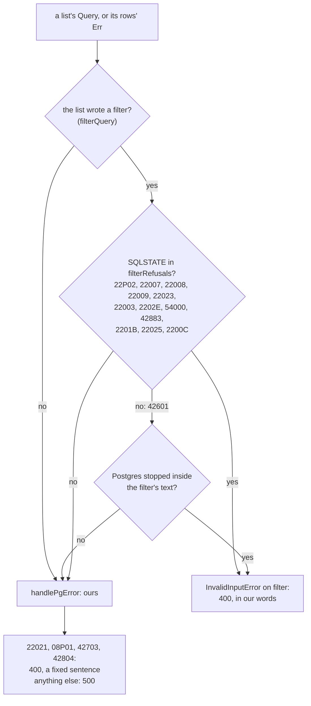
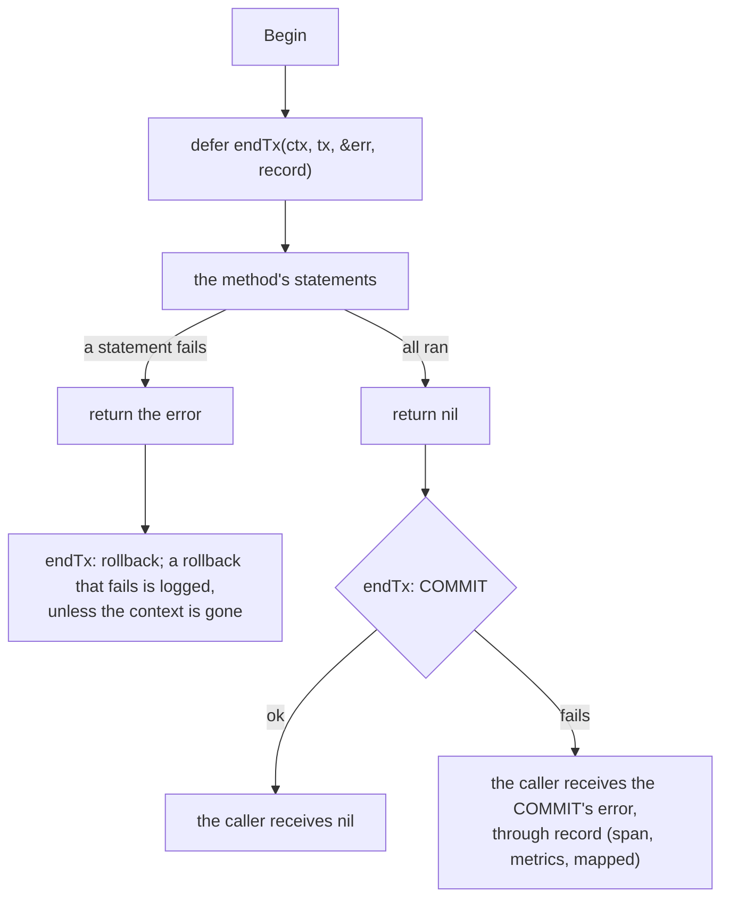

# Repository SQL rules

The rules every query in `internal/adapter/driven/repositorypg/` follows, and
the reachable injection each one was written against.

- **Always use `$n` placeholders for values.** Never `fmt.Sprintf` a value into a
  query. `repositorypg/roles.go` `UpdateByID` is the worked example, and its
  comment records the reachable injection it used to carry: role-name validation
  forbids control characters, HTML and null bytes but permits an apostrophe, so
  `x', description='injected` closed the literal and appended an
  attacker-controlled assignment. It was the only repository in the package not
  already using placeholders.
- **Identifiers that must be interpolated** (a schema or table name computed at
  runtime) go through `pgx.Identifier{schema, table}.Sanitize()` — never
  `strings.ReplaceAll` and never `fmt.Sprintf`. The hazard is less any single
  rule than two files in one package handling the same value under two different
  ones.
- **Values that cannot be placeholders** (a distance operator, a sort direction)
  must be validated against an allow-list before interpolation. The operator
  comes from `emb_vectors_functions.operator`, a column constrained only by NOT
  NULL and UNIQUE, so nothing in the database restricts it to a real operator.
- Neither of the two above is exploitable *today* — table names are derived from
  UUIDs and the operator rows are seeded — and that is exactly why both are
  enforced in code rather than argued about. "Safe because of where the value
  happens to come from" stops being true the first time someone adds a row.
- 22 files in the repository layer still import `html/template` to build SQL and
  use `template.HTML(...)` to defeat escaping. That is a historical wart, not a
  pattern to follow — new query builders should use `text/template` plus explicit
  sanitisation.

- **A link names each pair once.** The bulk links (a project's users, a
  user's projects, a user's roles, a role's users, a role's policies) are one
  statement each: `INSERT ... SELECT DISTINCT * FROM UNNEST($1::uuid[],
  $2::uuid[]) ON CONFLICT ... DO UPDATE`. Postgres refuses to update one row
  twice in one statement (SQLSTATE 21000), so without `DISTINCT` a body that
  named an id twice was a `500`. Naming it twice is naming it: one link, a
  `200`. `TestEveryLinkStatementSelectsEachPairOnce` reads the repository's
  source for every such statement, and `TestALinkThatNamesAnIdTwiceLinksItOnce`
  sends each route a repeated id against a running service.

## A filter Postgres refuses is a 400, in our words

The filter parser checks an expression's shape and its field names, in
PostgreSQL 18's grammar: qfv's default dialect, and the service's database, so
the parser accepts what the statement will run (`first_name LIKE 'a!_b'
ESCAPE '!'` since qfv v1.1.0, and what PostgreSQL refuses of that clause is
refused as an invalid expression). It does not know a column's type. So `GET /users?filter=id = 'nope'`, `disabled =
'maybe'` and `id = 1` passed it, Postgres refused the cast or found no
operator, and the driver's error went up unmapped: a 500 that said nothing,
and an ERROR line for a caller's mistake.

- **Every list that writes the caller's filter hands its query's error and
  its rows' error to `filterRefusal`** (`pg_common.go`) before
  `handlePgError`, with the clause it wrote and the statement it ran
  (`TestEveryFilteredListMapsPostgresRefusals`). The SQLSTATEs a filter can
  raise are spelled out, never "class 22": the class also holds what a
  caller cannot cause, which stays ours. A syntax error is the filter's only
  when Postgres's `Position` is inside the filter's text.
- **Only with a filter.** Nothing else in a list's statement is the caller's
  text: the sort is re-parsed, the fields are the repository's own columns,
  the cursor is built from the row it names.
- **Our words, never Postgres's.** The refusal does not wrap the driver's
  error. The four errors every repository answers as a 400 (22021, 08P01,
  42703, 42804) carried `pgErr.Message`: the statement's aliases and the
  caller's value, and a Postgres or driver upgrade rewrote them. They carry a
  fixed sentence (`TestNoDriverTextInABody`), and every repository maps all
  four (the rate limits' mapped only 22021, and answered the other three
  500).
  `TestAFilterIsRefusedInTheServicesWords` pins each against a running
  service.

## A transaction is ended by the error the caller receives

`endTx` (`repositorypg/tx.go`) ends a transaction: it rolls back when the
method is returning an error and commits when it is returning nil, and it
reads **the value the caller receives**, through a pointer to the named
result. A failed COMMIT becomes that result. A deferred closure that commits
"when `txErr` is nil" reads a local instead: it commits on every error path
that returns without setting it, and a failed COMMIT inside it can only be
logged, while the method has already answered nil.

`UsersRepository.Insert` and `ProjectsRepository.Insert` were written that
way. Both set the local on every error path, so neither committed a partial
write; but a COMMIT that failed was logged and the method returned nil, and
the route answered 201 for an account or a project that was never stored.

`TestNoTransactionIsEndedInADeferredClosure` fails on a `Commit` inside a
deferred function literal, on a deferred `Commit`, and on `endTx` given a
pointer to anything but the method's named result, anywhere in the package.
`TestEndTx` and `TestEndTxReachesTheCaller` hold the helper. A deferred
`Rollback` before an explicit `Commit` (the resource limits' and the rate
limits' transactions) is not among the shapes refused: after a commit it does
nothing, and it decides nothing.
